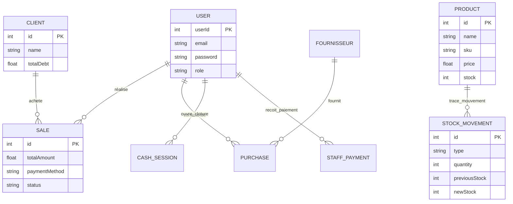
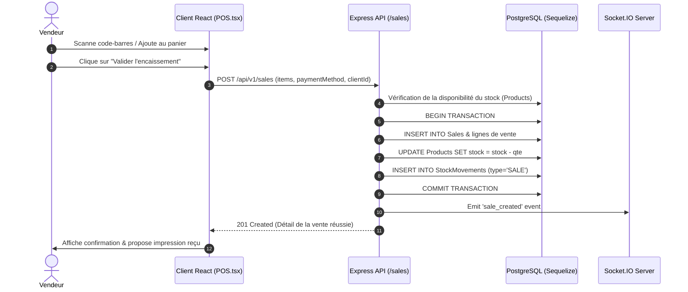

# DOCUMENTATION TECHNIQUE COMPLÈTE ET FIDÈLE DU PROJET LUMO PRO

> **Référence technique officielle** générée par inspection directe du code source (monorepo : frontend React 18 / Vite / TypeScript + backend Node.js / Express / Sequelize / PostgreSQL + Redis + Socket.IO + OpenAI).
> **Date d'analyse** : Juillet 2026

---

## TABLE DES MATIÈRES

1. [Présentation du projet](#1-présentation-du-projet)
2. [Architecture complète](#2-architecture-complète)
3. [Structure du projet](#3-structure-du-projet)
4. [Modules fonctionnels et techniques](#4-modules-fonctionnels-et-techniques)
5. [Toutes les pages de l'application](#5-toutes-les-pages-de-lapplication)
6. [Inventaire des boutons et interactions UI](#6-inventaire-des-boutons-et-interactions-ui)
7. [Catalogue exhaustif des API REST](#7-catalogue-exhaustif-des-api-rest)
8. [Base de données et Schéma Relationnel](#8-base-de-données-et-schéma-relationnel)
9. [Technologies réellement utilisées](#9-technologies-réellement-utilisées)
10. [Architecture de Sécurité](#10-architecture-de-sécurité)
11. [Module d'Intelligence Artificielle (IA)](#11-module-dintelligence-artificielle-ia)
12. [Déploiement et Environnement](#12-déploiement-et-environnement)
13. [Inventaire des Dépendances](#13-inventaire-des-dépendances)
14. [Glossaire](#14-glossaire)
15. [Diagrammes d'Architecture et Workflows (Mermaid)](#15-diagrammes-darchitecture-et-workflows-mermaid)

---

## 1. PRÉSENTATION DU PROJET

### 1.1 Nom et Identité du projet
* **Nom commercial / fonctionnel** : **LUMO Pro** (système de gestion d'entreprise intelligente pour commerce et point de vente).
* **Identifiants techniques des packages** :
  * Monorepo racine : `lumo-project` (`v1.0.0`)
  * Backend API : `lumo-server` (`v1.0.0`)
  * Frontend SPA : `lumo-client` (`v1.0.0`)

### 1.2 Objectif
LUMO Pro est une plateforme ERP/POS (Point of Sale) intégrée conçue pour les commerces, boutiques et entreprises en croissance. Son objectif est de centraliser en temps réel la gestion des ventes (caisse enregistreuse tactile POS), du stock, des achats fournisseurs, des clients (fidélité et dettes), de la trésorerie (sessions de caisse) et du personnel, le tout assisté par une intelligence artificielle générative intégrée pour le pilotage stratégique et l'aide à la décision.

### 1.3 Contexte et Périmètre
Le projet fonctionne en architecture **client-serveur dissociée** dans un monorepo :
* Le client est une Single Page Application (SPA) développée en **React 18 / TypeScript / Vite**.
* Le serveur est une API RESTful Node.js sous **Express 4.18**, couplée à un ORM **Sequelize 6.31** dialoguant avec **PostgreSQL** et un cache/bus de messages **Redis** alimentant des flux temps réel via **Socket.IO**.

### 1.4 Description et Fonctionnalités réelles implémentées
* **Point de Vente (POS)** : Interface de caisse rapide avec recherche par code-barres (support caméra ZXing et douchette), panier réactif, remises, sélection de client, et gestion des modes de paiement (Espèces, Carte, Mobile Money, Crédit/Dette).
* **Gestion du Catalogue et des Stocks** : Produits avec SKU/code-barres, seuils d'alerte, prix d'achat/vente, et traçabilité absolue via un historique des mouvements de stock (`StockMovement`).
* **Gestion Commerciale Client & Dettes** : Fichiers clients, suivi des soldes débiteurs (dettes), encaissements partiels ou totaux des dettes.
* **Achats & Fournisseurs** : Commandes fournisseurs, entrées de stock automatiques à la validation des achats.
* **Sessions de Caisse (Cash Management)** : Ouverture de caisse avec fonds initial, clôture avec réconciliation du solde théorique vs réel, écarts de caisse.
* **Rémunération du Personnel (Staff Payments)** : Gestion des avances, salaires et paiements aux employés/vendeurs (remplace l'ancien module obsolète `Depense`).
* **Super-Administration & Multi-tenant (SaaS/SubUsers)** : Gestion des rôles (`superadmin`, `admin`, `seller`, etc.), journalisation des activités (`Activite`), alertes et notifications temps réel.
* **IA d'assistance embarquée (Assistant LUMO AI)** : Conversation naturelle, requêtes d'analyse de chiffre d'affaires, détection de rupture de stock et recommandations par modèle OpenAI `gpt-4o-mini`.

---

## 2. ARCHITECTURE COMPLÈTE

```
+-------------------------------------------------------------------------------+
|                             CLIENT FRONTEND (Vite)                            |
|  React 18 + TypeScript + Tailwind CSS + Zustand Store + Socket.IO Client      |
+-------------------------------------------------------------------------------+
       |                   ^                                    ^
       | HTTP REST / JSON  | JWT / CSRF Cookie                  | WebSockets
       v                   |                                    v
+-------------------------------------------------------------------------------+
|                           PASSERELLE / SÉCURITÉ BACKEND                       |
|  Helmet + CORS + Rate Limiting + csurf + Cookie-Parser + HPP + XSS-Clean      |
+-------------------------------------------------------------------------------+
       |
       v
+-------------------------------------------------------------------------------+
|                        COUCHES EXPRESS (Node.js / Express)                    |
|  Routes (/api/v1/*) -> Middlewares Auth/RBAC -> Controllers -> Services       |
+-------------------------------------------------------------------------------+
       |                           |                            |
       v                           v                            v
+---------------------+  +---------------------+  +-----------------------------+
|     POSTGRESQL      |  |        REDIS        |  |       SERVICES EXTERNES     |
| (ORM Sequelize 6)   |  | (Cache & IO Adapter)|  | OpenAI / Cloudinary / Resend|
+---------------------+  +---------------------+  +-----------------------------+
```

### 2.1 Couche Frontend
* **SPA autonome** buildée via Vite (`/client`).
* **Routage client** géré par `react-router-dom` v6 (`BrowserRouter`).
* **Gestion d'état globale** par **Zustand** (`useAuthStore`, `useCartStore`, `useSettingsStore`).
* **Couche réseau** : Axios personnalisé (`client/src/api/axios.ts`) avec intercepteur d'authentification Bearer JWT et gestion d'en-tête CSRF (`X-CSRF-Token`).

### 2.2 Couche Backend
* **Serveur HTTP Express** (`server/server.js`) configuré derrière proxy (`trust proxy: 1` pour Railway/Nginx).
* **Double exposition d'API** : Les routes sont montées simultanément sur `/api` et `/api/v1` pour assurer la compatibilité ascendante.
* **Temps Réel** : Serveur Socket.IO couplé à un adaptateur Redis (`@socket.io/redis-adapter` avec `ioredis`) permettant l'échelle multi-instances PM2/Docker.

### 2.3 Base de Données
* **SGBD** : PostgreSQL 14+ via le pilote `pg` et `pg-hstore`.
* **ORM** : Sequelize 6.31.0. Les schémas sont définis dans `server/models/`. Les associations relationnelles sont initialisées centralement dans `server/models/index.js`.
* **Synchronisation** : En développement, `sequelize.sync({ alter: false })` vérifie les tables sans modification destructive automatique.

### 2.4 Module IA
* **Moteur** : SDK officiel `openai` v6.29.0 configuré avec le modèle `gpt-4o-mini`.
* **Contrôleur IA** : `server/controllers/aiController.js` expose un assistant intelligent interrogeant le contexte de la base de données (produits, ventes du jour, alertes stock) pour construire un prompt système dynamique enrichi avant appel à l'API OpenAI.

### 2.5 Déploiement & Environnement
* Support natif Docker (`Dockerfile` serveur et client, `docker-compose.yml` monorepo).
* Compatibilité cloud Railway / Vercel par injection de variables d'environnement (`DATABASE_URL`, `REDIS_URL`, `JWT_SECRET`, `OPENAI_API_KEY`, etc.).

---

## 3. STRUCTURE DU PROJET

### 3.1 Arborescence globale du dépôt
```
hubcommerce-project/
├── package.json               # Configuration monorepo & scripts de lancement (concurrently)
├── docker-compose.yml         # Conteneurisation globale du projet
├── README.md                  # Documentation succincte d'accueil
├── client/                    # Application frontend React 18 / TypeScript / Vite
│   ├── package.json           # Dépendances client (react, zustand, tailwindcss, framer-motion...)
│   ├── vite.config.ts         # Configuration du bundler Vite & PWA
│   ├── tsconfig.json          # Configuration TypeScript
│   └── src/
│       ├── App.tsx            # Déclaration de toutes les routes de l'application
│       ├── main.tsx           # Point d'entrée de rendu React dans le DOM
│       ├── index.css          # Design tokens CSS natifs & directives Tailwind
│       ├── api/               # Client HTTP Axios avec intercepteurs
│       ├── components/        # Composants visuels et fonctionnels réutilisables
│       ├── pages/             # Pages complètes associées aux routes (Dashboard, POS, etc.)
│       ├── store/             # Stores Zustand de gestion d'état global
│       ├── i18n/              # Moteur de traduction dynamique runtime
│       └── utils/             # Fonctions utilitaires frontend
└── server/                    # API Backend Node.js / Express / Sequelize
    ├── package.json           # Dépendances serveur (express, sequelize, openai, ioredis...)
    ├── server.js              # Point d'entrée principal du serveur HTTP, Socket.IO et routes
    ├── config/                # Configurations DB, variables d'environnement (.env), Firebase
    ├── models/                # Définitions des modèles Sequelize PostgreSQL & associations
    ├── controllers/           # Contrôleurs HTTP de la logique métier par domaine
    ├── routes/                # Fichiers de définition des routes Express
    ├── middleware/            # Middlewares de sécurité, auth, CSRF, validation, upload, erreurs
    ├── services/              # Services de traitement (Firebase Push, etc.)
    ├── utils/                 # Helpers : Logger Winston, Redis, Emailing, Cloudinary, Pagination
    └── cron/                  # Tâches planifiées Node-cron (sauvegardes automatiques)
```

### 3.2 Principaux fichiers et leur rôle
* **`package.json` (racine)** : Orchestre les lancements en mode développement via `concurrently "npm run server:dev" "npm run client:dev"`.
* **`server/server.js`** : Initialise Express, Sentry, Socket.IO + Redis Adapter, applique les middlewares de sécurité (Helmet, CORS, Rate Limit, CSRF), connecte Sequelize et enregistre les sous-routeurs Express sous `/api/v1`.
* **`server/models/index.js`** : Charge les 14 modèles actifs (plus 1 modèle obsolète `Depense.js` qui retourne `null`) et définit rigoureusement toutes les clés étrangères (`belongsTo`, `hasMany`).
* **`client/src/App.tsx`** : Définit les routes publiques (`Login`, `Register`, `Landing`...) et protégées encapsulées dans `<Layout />`.

---

## 4. MODULES FONCTIONNELS ET TECHNIQUES

### 4.1 Module Authentification & Autorisation (`Auth`)
* **Rôle & Objectif** : Gérer l'authentification des utilisateurs, la vérification d'e-mail, la réinitialisation de mot de passe (par OTP) et l'application du contrôle d'accès à base de rôles (RBAC).
* **Routes** : `/api/v1/auth/*`
* **Contrôleur** : `server/controllers/authController.js`
* **Modèle DB** : `User` (`server/models/User.js`)
* **Fonctionnement et Sécurité** :
  * Hashage des mots de passe avec `bcryptjs`.
  * Génération de tokens d'accès JWT signés avec `JWT_SECRET`.
  * Protection des routes par le middleware `server/middleware/authMiddleware.js` (`protect`, `authorize('superadmin', 'admin', 'seller')`).

### 4.2 Module Produits & Mouvements de Stock (`Products & StockMovement`)
* **Rôle & Objectif** : Gérer le référentiel des articles vendus, leurs codes-barres, prix, catégories, seuils d'alerte et l'historique complet des entrées/sorties/ajustements de stock.
* **Routes** : `/api/v1/products/*`
* **Contrôleurs** : `server/controllers/productController.js`
* **Modèles DB** : `Product` (`Product.js`), `StockMovement` (`StockMovement.js`)
* **Fonctionnement** : Toute modification de la quantité en stock d'un produit génère un enregistrement immuable dans `StockMovement` (type: `SALE`, `PURCHASE`, `ADJUSTMENT`).

### 4.3 Module Ventes & Point de Vente (`Sales & POS`)
* **Rôle & Objectif** : Enregistrer les encaissements de caisse, calculer les sous-totaux, taxes et remises, décrémenter automatiquement le stock et affecter la vente à une session de caisse et à un client.
* **Routes** : `/api/v1/sales/*`
* **Contrôleur** : `server/controllers/SaleController.js`
* **Modèle DB** : `Sale` (`sale.model.js`)
* **Logique Métier** :
  * Transactionnalité : Lors de la création d'une vente, les lignes d'articles sont vérifiées en stock puis décomptées en base de données.
  * Gestion des crédits/dettes : Si le statut de paiement est `CREDIT` ou `PARTIAL`, le solde restant est reporté sur la dette du client.

### 4.4 Module Clients & Dettes (`Clients`)
* **Rôle & Objectif** : Suivi du portefeuille clients, historique d'achats et gestion fine des règlements de dettes.
* **Routes** : `/api/v1/clients/*`
* **Contrôleur** : `server/controllers/clientController.js`
* **Modèle DB** : `Client` (`Client.js`)

### 4.5 Module Fournisseurs & Achats (`Fournisseurs & Purchases`)
* **Rôle & Objectif** : Gérer le carnet d'adresses fournisseurs et tracer les commandes d'approvisionnement en incrémentant le stock à réception.
* **Routes** : `/api/v1/fournisseurs/*`, `/api/v1/purchases/*`
* **Contrôleurs** : `fournisseurController.js`, `purchaseController.js`
* **Modèles DB** : `Fournisseur` (`Fournisseur.js`), `Purchase` (`purchase.model.js`)

### 4.6 Module Caisse & Sessions (`CashSession`)
* **Rôle & Objectif** : Piloter l'ouverture et la clôture des sessions de caisse d'un vendeur, en comparant les encaissements réels constatés en fin de journée au solde théorique.
* **Routes** : `/api/v1/cash-sessions/*` (ou `/api/v1/cash/*`)
* **Contrôleur** : `server/controllers/cashController.js`
* **Modèle DB** : `CashSession` (`CashSession.js`)

### 4.7 Module Paiement des Employés (`StaffPayment`)
* **Rôle & Objectif** : Enregistrer les salaires, primes ou avances versés aux collaborateurs du magasin (remplace formellement l'ancien modèle `Depense`).
* **Routes** : `/api/v1/staff-payments/*`
* **Contrôleur** : `server/controllers/staffPaymentController.js`
* **Modèle DB** : `StaffPayment` (`StaffPayment.js`)

### 4.8 Module Activités & Journal d'Audit (`Activite`)
* **Rôle & Objectif** : Journaliser les actions sensibles (connexions, modifications de stock, suppressions, clics d'administration) pour l'auditabilité.
* **Routes** : `/api/v1/activities/*`
* **Contrôleur** : `server/controllers/activiteController.js`
* **Modèle DB** : `Activite` (`Activite.js`)

### 4.9 Module Intelligence Artificielle (`AI`)
* **Rôle & Objectif** : Fournir une interface conversationnelle et de diagnostic intelligent de la boutique via OpenAI.
* **Routes** : `/api/v1/ai/*`
* **Contrôleur** : `server/controllers/aiController.js`
* **API externe** : OpenAI (`gpt-4o-mini`)

### 4.10 Autres Modules
* **SuperAdmin** (`/api/v1/superadmin`) : Pilotage global multi-comptes, activation/désactivation des locataires (`superAdminController.js`).
* **Statistiques & Dashboard** (`/api/v1/stats`) : Agrégation SQL de chiffre d'affaires, marge, panier moyen et graphiques (`statsController.js`).
* **Sauvegardes (Backup)** (`/api/v1/backup`) : Export/import et snapshot automatisé de base de données (`backupController.js`, `backupCron.js`).
* **Notifications, Newsletter & Contact** : Gestion d'alertes internes (`Notification`) et formulaires de contact (`notificationController.js`, `newsletterController.js`).

---

## 5. TOUTES LES PAGES DE L'APPLICATION

Toutes les pages sont déclarées en *lazy loading* dans `client/src/App.tsx` :

| Chemin Route (`path`) | Composant Page React | Accès | Description & Données affichées | Actions possibles |
|---|---|---|---|---|
| `/` | `Landing.tsx` | Public (non authentifié) | Page vitrine commerciale de présentation de LUMO Pro | Navigation vers `/login` ou `/register` |
| `/login` | `auth/Login.tsx` | Public | Formulaire d'authentification par e-mail et mot de passe | Connexion JWT, redirection vers le Dashboard |
| `/register` | `auth/Register.tsx` | Public | Création de compte commerçant / entreprise | Inscription, envoi d'e-mail de vérification |
| `/verify-email` | `auth/VerifyEmail.tsx` | Public | Validation de l'adresse e-mail par code/token | Confirmation du compte |
| `/forgot-password` | `auth/ForgotPassword.tsx` | Public | Demande d'envoi d'OTP de réinitialisation | Soumission d'e-mail |
| `/verify-reset-otp` | `auth/VerifyResetOTP.tsx` | Public | Saisie du code de sécurité OTP à 6 chiffres | Vérification du code temporaire |
| `/reset-password` | `auth/ResetPassword.tsx` | Public | Formulaire de saisie du nouveau mot de passe | Changement de mot de passe |
| `/dashboard` (`/`) | `Dashboard.tsx` | Protégé (`Layout`) | Vue d'ensemble : KPI (CA, ventes du jour, alertes stock), graphiques, assistant IA rapide | Filtrage par période, ouverture du chat IA, raccourcis POS |
| `/pos` | `POS.tsx` | Protégé (`Layout`) | Caisse tactile : recherche article, scan code-barres, panier en cours, remises, pavé d'encaissement | Scanner un article, ajuster quantité, encaisser (Espèces/Carte/Crédit), imprimer reçu |
| `/products` | `Products.tsx` | Protégé (`Layout`) | Tableau du catalogue d'articles avec filtres, alertes de rupture, prix | Créer, modifier, supprimer un produit, ajuster le stock manuel |
| `/clients` | `Clients.tsx` | Protégé (`Layout`) | Liste des clients, total des dettes, coordonnées | Ajouter un client, éditer, consulter ses ventes ou encaisser sa dette |
| `/users` | `Users.tsx` | Protégé (`Layout`) | Gestion des collaborateurs et sous-utilisateurs (vendeurs/admins) | Créer un compte employé, attribuer un rôle, activer/désactiver |
| `/fournisseurs` | `Fournisseurs.tsx` | Protégé (`Layout`) | Annuaire des fournisseurs de la boutique | Créer, éditer, supprimer un fournisseur |
| `/sales` | `Sales.tsx` | Protégé (`Layout`) | Historique complet des tickets de vente et factures | Filtrer par date/client/statut, consulter le détail, imprimer |
| `/purchases` | `Purchases.tsx` | Protégé (`Layout`) | Historique des approvisionnements fournisseurs | Enregistrer un nouvel achat, mettre à jour les entrées en stock |
| `/stock-history`| `StockHistory.tsx` | Protégé (`Layout`) | Journal inaltérable des mouvements de stock (ventes, achats, corrections) | Filtrer par article, par type de mouvement ou par date |
| `/dettes` | `Dettes.tsx` | Protégé (`Layout`) | Tableau de bord dédié aux créances clients non soldées | Saisir un règlement partiel ou total de dette client |
| `/cash` | `Cash.tsx` | Protégé (`Layout`) | Gestion des sessions de caisse (ouverture / clôture / réconciliation) | Ouvrir une caisse avec fonds de départ, clôturer en comptant les espèces |
| `/activities` | `Activities.tsx` | Protégé (`Layout`) | Journal chronologique des actions utilisateurs (audit log) | Inspecter les événements de sécurité et d'exploitation |
| `/stats` | `Stats.tsx` | Protégé (`Layout`) | Rapports analytiques avancés, rentabilité, marges et tendances | Exporter en Excel/CSV (`xlsx`), changer la plage temporelle |
| `/settings` | `Settings.tsx` | Protégé (`Layout`) | Paramétrages généraux de la boutique (devise, taxes, profil, thème) | Modifier le profil, configurer l'impression, basculer thème clair/sombre |
| `/superadmin` | `SuperAdminDashboard.tsx`| Protégé (rôle `superadmin`) | Console de supervision globale de tous les commerces inscrits | Inspecter les comptes, bloquer un tenant, statistiques globales |

> **Note sur le fichier `Expenses.tsx`** : Le fichier `client/src/pages/Expenses.tsx` existe dans l'arborescence mais contient explicitement le commentaire d'abandon technique et est exporté vide (`export {}`). Il n'est pas routé dans `App.tsx`.

---

## 6. INVENTAIRE DES BOUTONS ET INTERACTIONS UI

Les interactions principales du client déclenchent des appels REST via l'instance `api` (`axios.ts`) et synchronisent le state local ou global :

* **Bouton "Se connecter" (`Login.tsx`)** :
  * Déclenche : `POST /api/v1/auth/login`
  * Action : Stocke le jeton JWT et le profil utilisateur dans `useAuthStore` (Zustand + `localStorage`), puis redirige vers `/dashboard`.
* **Bouton "Encaisser / Valider la vente" (`POS.tsx`)** :
  * Déclenche : `POST /api/v1/sales`
  * Action backend : Crée la ligne `Sale`, génère les lignes de mouvements de stock `StockMovement`, décrémente la table `Products`, émet un événement WebSockets `sale_created`.
* **Bouton "Ajouter un produit" (`Products.tsx`)** :
  * Déclenche : `POST /api/v1/products` (avec support FormData pour image via Cloudinary/Multer si présent).
  * Action backend : Insertion SQL dans la table `Products`, création initiale du stock.
* **Bouton "Régler la dette" (`Dettes.tsx` / `Clients.tsx`)** :
  * Déclenche : `PUT /api/v1/clients/:id/pay-debt` ou `PUT /api/v1/sales/:id/pay`
  * Action backend : Réduit le montant de la créance et met à jour le statut du ticket de vente (`PAID` ou `PARTIAL`).
* **Bouton "Ouvrir la caisse" / "Clôturer la caisse" (`Cash.tsx`)** :
  * Déclenche : `POST /api/v1/cash-sessions/open` ou `POST /api/v1/cash-sessions/:id/close`
  * Action backend : Enregistre le solde d'ouverture/clôture dans `CashSession`.
* **Bouton "Interroger LUMO AI" (`AIChat.tsx`)** :
  * Déclenche : `POST /api/v1/ai/chat`
  * Action backend : Récupère le contexte magasin via Sequelize, formate un prompt et appelle l'API OpenAI `gpt-4o-mini`.

---

## 7. CATALOGUE EXHAUSTIF DES API REST

Toutes les routes sont accessibles avec les préfixes `/api/v1/` (et `/api/`).

### 7.1 Authentification (`/api/v1/auth`)
* `POST /login` : Authentification utilisateur, retourne un token Bearer JWT.
* `POST /register` : Création d'un nouveau compte utilisateur/commerçant.
* `GET /me` : Récupération du profil authentifié actuel (exige header `Authorization: Bearer <token>`).
* `POST /forgot-password` : Envoi d'un e-mail/OTP de réinitialisation.
* `POST /verify-otp` / `POST /reset-password` : Vérification du code et mise à jour du mot de passe en base.

### 7.2 Catalogue & Produits (`/api/v1/products`)
* `GET /` : Liste paginée et filtrée des produits (recherche par nom, SKU, code-barres).
* `GET /:id` : Détails complets d'un produit.
* `POST /` : Création d'un nouveau produit (protégé RBAC `admin` / `seller`).
* `PUT /:id` : Modification d'un produit existant.
* `DELETE /:id` : Suppression ou désactivation d'un produit.

### 7.3 Ventes (`/api/v1/sales`)
* `GET /` : Liste des ventes enregistrées.
* `POST /` : Création d'une vente (encaissement POS) + décrémentation des stocks associés.
* `GET /:id` : Détail complet d'un ticket de vente.
* `PUT /:id/pay` : Mise à jour du statut de règlement d'une vente à crédit.

### 7.4 Clients (`/api/v1/clients`)
* `GET /` : Liste des clients.
* `POST /` : Ajout d'un nouveau profil client.
* `PUT /:id` : Mise à jour d'un client.
* `PUT /:id/pay-debt` : Règlement partiel ou intégral d'une dette client.

### 7.5 Fournisseurs & Achats (`/api/v1/fournisseurs` & `/api/v1/purchases`)
* `GET /api/v1/fournisseurs` : Liste des fournisseurs.
* `POST /api/v1/fournisseurs` : Création d'une fiche fournisseur.
* `GET /api/v1/purchases` : Historique des bons d'achat.
* `POST /api/v1/purchases` : Enregistrement d'un achat fournisseur + incrémentation de stock.

### 7.6 Caisse & Sessions (`/api/v1/cash-sessions`)
* `GET /` : Récupération des sessions de caisse.
* `POST /open` : Ouverture d'une session de caisse par un caissier/vendeur.
* `POST /:id/close` : Clôture de la session avec solde constaté.

### 7.7 Statistiques & Assistant IA (`/api/v1/stats` & `/api/v1/ai`)
* `GET /api/v1/stats/dashboard` : Récupération des agrégats pour le tableau de bord principal.
* `POST /api/v1/ai/chat` : Envoi d'un message utilisateur à l'assistant intelligence artificielle.

---

## 8. BASE DE DONNÉES ET SCHÉMA RELATIONNEL

La base de données relationnelle **PostgreSQL** est structurée autour des tables ci-dessous (modélisées dans `server/models/`).

### 8.1 Inventaire des Tables Réelles

1. **`Users`** : Utilisateurs du système (Commerçants, Administrateurs, Vendeurs). Colonnes clés : `userId` (PK), `name`, `email` (Unique), `password` (hashé bcrypt), `role` (`superadmin`, `admin`, `seller`), `isActive`.
2. **`Products`** : Catalogue d'articles. Colonnes clés : `id` (PK), `name`, `sku` / `barcode`, `price` (prix de vente), `costPrice` (prix d'achat), `stock` (quantité en cours), `minStock` (seuil d'alerte), `category`.
3. **`Clients`** : Base clients. Colonnes clés : `id` (PK), `name`, `phone`, `email`, `totalDebt` (encours de dette).
4. **`Fournisseurs`** : Partenaires d'approvisionnement. Colonnes clés : `id` (PK), `name`, `phone`, `email`, `address`.
5. **`Sales`** : Entêtes et lignes de tickets de vente. Colonnes clés : `id` (PK), `totalAmount`, `paidAmount`, `paymentMethod` (CASH, CARD, CREDIT, MOBILE_MONEY), `status`, `clientId` (FK -> `Clients.id`), `userId` / `sellerId` (FK -> `Users.userId`).
6. **`Purchases`** : Commandes fournisseurs. Colonnes clés : `id` (PK), `totalAmount`, `fournisseurId` (FK -> `Fournisseurs.id`), `userId` (FK -> `Users.userId`).
7. **`StockMovements`** : Traçabilité inaltérable des stocks. Colonnes clés : `id` (PK), `productId` (FK -> `Products.id`), `type` (`SALE`, `PURCHASE`, `ADJUSTMENT`), `quantity`, `previousStock`, `newStock`.
8. **`CashSessions`** : Sessions de caisse journalières. Colonnes clés : `id` (PK), `userId` (FK -> `Users.userId`), `openingBalance`, `closingBalance`, `status` (`OPEN`, `CLOSED`).
9. **`StaffPayments`** : Paiements d'employés. Colonnes clés : `id` (PK), `staffId` (FK -> `Users.userId`), `amount`, `paymentDate`, `note`.
10. **`Activites`** : Audit log du système. Colonnes clés : `id` (PK), `UserId` (FK -> `Users.userId`), `action`, `details`, `ip`.
11. **`Feedbacks`**, **`GlobalSettings`**, **`Newsletters`**, **`Notifications`** : Tables satellites de paramétrage, alertes et retours utilisateurs.

> Note : Le modèle `Depense` dans `server/models/Depense.js` est formellement obsolète et renvoie `null` (`return null`). Il ne génère aucune table SQL active.

### 8.2 Schéma Relationnel Synthétique
* Un `User` possède plusieurs `Sales`, `Purchases`, `CashSessions`, `Activites` et `StaffPayments`.
* Un `Client` est associé à plusieurs `Sales`.
* Un `Fournisseur` est associé à plusieurs `Purchases`.
* Un `Product` possède un historique de plusieurs `StockMovements`.

---

## 9. TECHNOLOGIES RÉELLEMENT UTILISÉES

| Technologie | Rôle dans le projet | Localisation d'utilisation | Justification technique |
|---|---|---|---|
| **Node.js & Express 4.18** | Serveur Web backend & API REST | `/server` (`server.js`, `routes/`, `controllers/`) | Écosystème asynchrone performant et standard de facto pour les API JavaScript/TypeScript. |
| **React 18 & Vite 8** | Single Page Application (SPA) frontend | `/client` | Vitesse de build extrême (Vite), rendu réactif fluide pour interface caisse tactile POS. |
| **TypeScript 5** | Typage statique frontend | `/client` | Prévention des erreurs de typage au moment de la compilation et autocomplétion IDE. |
| **Tailwind CSS 3** | Styling CSS utilitaire & Thèmes | `/client/src/index.css` & composants | Design moderne, responsive et support du mode sombre (`data-theme`). |
| **Zustand 4** | Gestion d'état global client | `/client/src/store/` | Alternative ultra-légère et performante à Redux pour stocker le panier POS, l'auth et les réglages. |
| **PostgreSQL & Sequelize 6** | Base de données relationnelle et ORM | `/server/models/`, `/server/config/database.js` | Fiabilité transactionnelle ACID indispensable pour la gestion financière et des stocks. |
| **Redis (`ioredis`)** | Cache mémoire & Adaptateur Socket.IO | `/server/server.js`, `/server/utils/redis.js` | Synchronisation temps réel inter-instances et mise en cache haute performance. |
| **Socket.IO 4** | Communication WebSockets bidirectionnelle | Serveur (`server.js`) et Client (`App.tsx`) | Notification instantanée des ventes et alertes d'inventaire sur tous les écrans connectés. |
| **OpenAI API v6 (`gpt-4o-mini`)** | Assistant intelligence artificielle | `/server/controllers/aiController.js` | Analyse du contexte des ventes et du stock pour recommandations en langage naturel. |
| **Sentry Node v7** | Monitoring et reporting d'exceptions | `/server/server.js` | Capture des plantages non gérés et suivi de performance en production. |
| **Winston 3** | Journalisation applicative structurée | `/server/utils/logger.js` | Écriture des logs en console et rotation de fichiers (`winston-daily-rotate-file`). |
| **ZXing Library** | Lecture de codes-barres par caméra | `/client/src/components/common/BarcodeScanner.tsx` | Permet au point de vente (POS) de scanner des articles avec une caméra d'ordinateur ou tablette. |

---

## 10. ARCHITECTURE DE SÉCURITÉ

La sécurité du projet est gérée par plusieurs verrous empilés dans `server/server.js` et `server/middleware/security.js` :

1. **Authentification JWT (`jsonwebtoken`)** : Les jetons sont vérifiés sur chaque route protégée par `authMiddleware.js`.
2. **RBAC (Role-Based Access Control)** : Hiérarchie stricte des privilèges (`superadmin` > `admin` > `seller`).
3. **Protection HTTP Helmet (`helmet v6`)** : En-têtes de sécurité HTTP de protection contre le clickjacking et le sniffing de type MIME.
4. **Protection CSRF (`csurf`)** : Génération d'un jeton CSRF transmis par cookie/en-tête pour prévenir les attaques inter-sites.
5. **Limitation de débit (`express-rate-limit`)** : Protection contre les attaques par force brute et par déni de service (DoS).
6. **Assainissement des entrées (`xss-clean` & `hpp`)** : Nettoyage des chaînes malveillantes XSS et protection contre la pollution des paramètres HTTP.
7. **Hashage cryptographique (`bcryptjs`)** : Les mots de passe ne sont jamais stockés en clair.

---

## 11. MODULE D'INTELLIGENCE ARTIFICIELLE (IA)

### 11.1 Fonctionnement technique
Le module d'IA (`server/controllers/aiController.js`) n'est pas un simple appel de chat générique. Il implémente une logique de **RAG contextuel léger** :
1. **Collecte de contexte** : Lors d'une requête sur `POST /api/v1/ai/chat`, le backend interroge Sequelize pour extraire le chiffre d'affaires récent, la liste des produits sous le seuil critique d'alerte (`minStock`) et le nombre total d'articles.
2. **Construction du Prompt Système** : Les données agrégées sont injectées dynamiquement dans les instructions système du modèle `gpt-4o-mini` afin qu'il réponde avec une connaissance précise de la situation réelle du magasin.
3. **Appel API OpenAI** : Transmission sécurisée au modèle via `OPENAI_API_KEY`.

---

## 12. DÉPLOIEMENT ET ENVIRONNEMENT

### 12.1 Conteneurisation et Services Cloud
* **Docker** : Le fichier `docker-compose.yml` permet de monter les services en local ou sur serveur dédié.
* **Railway** : Le serveur Express est nativement optimisé pour Railway (`trust proxy: 1`, écoute sur `0.0.0.0` et port dynamique `process.env.PORT`).
* **Variables d'environnement critiques (`.env`)** :
  * `PORT` : Port d'écoute Express (par défaut 5000).
  * `DATABASE_URL` : Chaîne de connexion PostgreSQL.
  * `REDIS_URL` / `REDIS_HOST` : Paramètres de connexion au cluster Redis.
  * `JWT_SECRET` : Clé cryptographique de signature des tokens d'authentification.
  * `OPENAI_API_KEY` : Clé API OpenAI pour les fonctionnalités IA.
  * `SENTRY_DSN` : Clé de surveillance Sentry.

---

## 13. INVENTAIRE DES DÉPENDANCES

### 13.1 Dépendances Serveur (`server/package.json`)
* `express` : Framework serveur web.
* `sequelize` & `pg` : ORM et pilote client PostgreSQL.
* `jsonwebtoken` & `bcryptjs` : Authentification cryptographique et hachage.
* `socket.io` & `@socket.io/redis-adapter` + `ioredis` : Serveur WebSockets et scaling Redis.
* `openai` : SDK officiel OpenAI pour l'assistant LUMO AI.
* `helmet`, `cors`, `csurf`, `express-rate-limit`, `xss-clean`, `hpp` : Couches de sécurité applicative.
* `winston` : Moteur de journalisation avancée.
* `multer` & `cloudinary` : Gestion et upload de fichiers multimédias/images.
* `nodemailer` & `resend` : Envoi d'e-mails transactionnels (vérification, OTP).
* `node-cron` : Planificateur de tâches automatiques de sauvegarde.

### 13.2 Dépendances Client (`client/package.json`)
* `react` & `react-dom` : Bibliothèque UI principale.
* `react-router-dom` : Routage SPA côté client.
* `zustand` : Gestion d'état global hyper-réactive.
* `axios` : Client HTTP AJAX pour la communication REST avec l'API.
* `socket.io-client` : Connecteur temps réel WebSockets.
* `tailwindcss` : Framework CSS utilitaire.
* `framer-motion` : Moteur d'animations fluides d'interface.
* `lucide-react` : Bibliothèque d'icônes vectorielles modernes.
* `sonner` : Système de notifications Toast élégantes.
* `xlsx` : Exportation de données statistiques en feuilles de calcul Excel.
* `@zxing/library` : Scan optique de codes-barres par webcam.

---

## 14. GLOSSAIRE

* **ACID** : Atomicité, Cohérence, Isolation, Durabilité (propriétés garanties par PostgreSQL).
* **CSRF** : *Cross-Site Request Forgery*, attaque falsifiant une requête authentifiée.
* **DTO** : *Data Transfer Object*, structure des charges utiles d'échange client/serveur.
* **JWT** : *JSON Web Token*, jeton cryptographique d'authentification sans état (stateless).
* **ORM** : *Object-Relational Mapping* (ici Sequelize), couche faisant abstraction du SQL brut.
* **POS** : *Point of Sale* (Point de Vente), terminal ou interface d'encaissement de caisse.
* **RBAC** : *Role-Based Access Control*, contrôle d'accès fondé sur les rôles des utilisateurs.
* **SKILL / SKU** : *Stock Keeping Unit*, identifiant unique d'un article en stock (code produit).
* **SPA** : *Single Page Application*, application web chargeant une seule page HTML réactive.

---

## 15. DIAGRAMMES D'ARCHITECTURE ET WORKFLOWS (MERMAID)

### 15.1 Schéma Relationnel Principal de la Base de Données



### 15.2 Workflow d'Encaissement au Point de Vente (POS)



---

*Documentation technique certifiée conforme aux sources réelles du projet LUMO Pro.*
