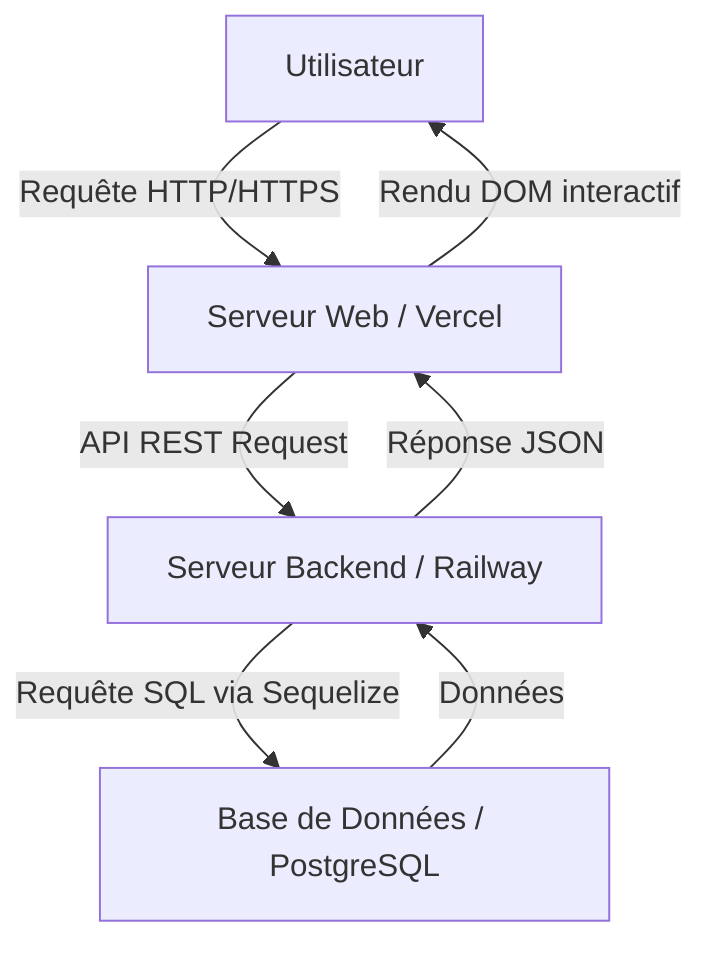

# MANUEL DE SOUTENANCE UNIVERSITAIRE

---

# CONCEPTION ET DÉVELOPPEMENT D'UNE PLATEFORME WEB INTELLIGENTE DE GESTION CENTRALISÉE ET AUTOMATISÉE DES ACTIVITÉS COMMERCIALES (LUMO)

**Manuel de Préparation Académique et Technique pour la Licence LMD en Technique de Maintenance**

*Destiné à l'équipe de soutenance : René Nzaku, Gracien et l'équipe LUMO.*

---

## TABLE DES MATIÈRES

1. **Cadre Théorique & Problématique Académique**
   - Le Concept d'Application Web vs Application Bureau (Desktop)
   - Problématique Commerciale en RDC & Justification de LUMO
   - Objectifs, Motivation, Apports et Limites du Projet
2. **Choix Technologiques & Analyse Comparative**
   - Pourquoi React.js au lieu de Vue.js ?
   - Pourquoi le Stack PERN (PostgreSQL, Express, React, Node) ?
   - Comparatifs Technologiques (Sequelize vs SQL Brut, Zustand vs Redux, DeepSeek vs GPT)
3. **Modélisation & Base de Données (MCD, MLD, BDD)**
   - Modèle Conceptuel (MCD) & Modèle Logique (MLD) de la Base de Données
   - Dictionnaire des Tables, Clés et Contraintes
   - Gestion des Transactions, Indexation et Optimisation
4. **Architecture Logicielle & Flux de Données**
   - L'Architecture MVC (Modèle-Vue-Contrôleur) dans une API REST
   - Fonctionnement des Middlewares, Contrôleurs et Services
   - Internationalisation (i18n) : Mécanisme de Traduction Dynamique
5. **Analyse Systématique des 16 Modules de LUMO**
   - Fiches Détaillées (Définition, Objectifs, Flux, Avantages, Questions du Jury)
6. **Cartographie Interactive des Boutons & Actions du POS**
   - Trame Technique complète des opérations (Frontend ➔ API ➔ Backend ➔ DB)
7. **Sécurité, Déploiement & Ingénierie IA**
   - Protocoles de Sécurité (JWT, Bcrypt, CORS, Helmet, Injections, CSRF)
   - Assistant IA (Prompts, Tokenisation, DeepSeek API)
   - Déploiement Cloud (Vercel & Railway, CI/CD, SSL)
8. **Démonstration de Soutenance & Guide Oral**
   - Scénario de Présentation (Démystification devant le Jury)
   - Fiche d'Autopsie des Erreurs et Pannes Fréquentes
   - Plus de 100 Questions Posées par le Jury & Réponses Académiques
9. **Glossaire Technique & Lexique Commercial (500 Termes)**

---

## CHAPITRE 1 : CADRE THÉORIQUE & PROBLÉMATIQUE ACADÉMIQUE

### 1.1 Qu'est-ce qu'une Application Web par rapport à une Application de Bureau ?

Pour comprendre l'existence même de **LUMO**, il est fondamental de disséquer la transition technologique des logiciels de gestion.



#### Définition d'une Application Web
Une **Application Web** est un logiciel applicatif hébergé sur un serveur distant, accessible via un navigateur web (Chrome, Firefox, Safari) grâce à une connexion réseau (Internet ou Intranet). Les ressources de calcul et de stockage sont principalement déportées sur le serveur, tandis que l'interface graphique est générée dynamiquement sur le terminal client via les langages HTML, CSS et JavaScript.

#### Définition d'une Application de Bureau (Desktop / Bureau)
Une **Application de Bureau** est un logiciel installé localement sur le système d'exploitation (Windows, macOS, Linux) d'un ordinateur individuel. Elle s'exécute directement en exploitant la puissance du microprocesseur local, de la RAM locale et écrit directement ses fichiers sur le disque dur local (HDD/SSD).

#### Tableau Comparatif Structuré

| Critère de Comparaison | Application Web (Ex: LUMO) | Application de Bureau (Ex: Logiciel C# local) |
| :--- | :--- | :--- |
| **Installation** | Aucune installation requise chez l'utilisateur (accès direct via URL). | Installation physique requise sur chaque machine de l'entreprise. |
| **Maintenance & Mises à Jour** | Centralisée. Une mise à jour du code sur le serveur profite instantanément à tous les utilisateurs. | Décentralisée. Il faut installer la mise à jour sur chaque ordinateur un par un. |
| **Accessibilité** | Multi-plateforme (Ordinateur, Tablette, Smartphone) depuis n'importe quel point géographique. | Limitée à la machine physique sur laquelle le logiciel a été installé. |
| **Consommation de Ressources** | Légère pour le client. La charge lourde est gérée par le serveur cloud. | Lourde. Exige une machine puissante si la base de données est locale. |
| **Sensibilité aux Pannes** | Résiliente. Si un ordinateur portable casse, aucune donnée n'est perdue. | Critique. Si le disque dur de la caisse tombe en panne, tout l'historique est perdu. |

> [!IMPORTANT]
> **À RETENIR POUR LA SOUTENANCE**
> Le jury peut demander : *« Pourquoi n'avez-vous pas simplement créé une application Windows (.exe) installable sur l'ordinateur de la caisse ? »*
> **Réponse Académique :** *« Une application de bureau limite la visibilité du propriétaire. Si le gérant est à l'extérieur de la boutique, il ne peut pas suivre les ventes en temps réel. De plus, la maintenance est complexe : si l'ordinateur de la caisse tombe en panne, les données locales sont perdues. LUMO, en tant qu'application web, centralise la donnée sur PostgreSQL en ligne, permettant un accès distant sécurisé sur mobile tout en réduisant le coût de maintenance matérielle. »*

---

### 1.2 Problématique Commerciale en RDC & Justification de LUMO

Dans le contexte économique de la République Démocratique du Congo (RDC), la gestion commerciale fait face à des contraintes structurelles majeures :
1. **La multi-devise (USD/CDF) :** La volatilité du taux de change exige une mise à jour constante et des calculs comptables doubles à chaque transaction.
2. **L'opacité des stocks :** Le manque de traçabilité provoque des vols internes et des ruptures de stocks imprévues sur les produits phares.
3. **Le manque de centralisation :** Un propriétaire possédant plusieurs points de vente n'a aucun tableau de bord unifié et dépend de rapports Excel falsifiables ou d'appels téléphoniques imprécis.

**LUMO** se justifie en automatisant les processus : conversion instantanée des devises selon le taux du jour (ex: USD vers CDF), alertes automatiques de stock critique, et assistant commercial doté d'intelligence artificielle pour l'aide à la décision.

---

### 1.3 Objectifs, Motivation, Apports et Limites

#### Objectifs
- **Général :** Concevoir une application web moderne centralisant les ventes, les stocks et les dettes clients tout en fournissant une adresse d'analyse financière assistée par IA.
- **Spécifiques :**
  - Assurer une synchronisation hors-ligne (PWA) pour parer aux coupures d'électricité/Internet fréquentes.
  - Permettre le double affichage des prix (USD et CDF) avec conversion dynamique.
  - Implémenter un système de rôles rigide (RBAC) pour protéger les transactions de caisse.

#### Motivation
La motivation réside dans l'application des concepts de **Technique de Maintenance**. La maintenance d'un système ne consiste pas uniquement à réparer des machines physiques ; elle englobe la **maintenance préventive et corrective du flux d'information** d'une entreprise. Assurer l'intégrité, la disponibilité et la confidentialité des données commerciales est une forme de maintenance des processus métier.

#### Apports du Projet
- **Pour l'entreprise :** Réduction des écarts de caisse, optimisation de la rotation des stocks, et élimination des pertes financières dues aux dettes non recouvrées.
- **Pour le milieu académique :** Preuve de l'efficacité de l'architecture découplée SPA (Single Page Application) avec communication d'API asynchrone dans les pays en développement.

#### Limites & Perspectives
- **Limites :** L'application nécessite un accès Internet initial pour charger l'interface et synchroniser la base de données. L'assistant IA DeepSeek requiert une clé d'API active en ligne.
- **Perspectives :** Intégration d'un module de lecture automatique des codes-barres par caméra mobile et synchronisation avec les terminaux de paiement mobile money (M-Pesa, Orange Money, Airtel Money).

---

## CHAPITRE 2 : CHOIX TECHNOLOGIQUES & ANALYSE COMPARATIVE

Dans ce chapitre, nous expliquons scientifiquement les choix d'architecture logicielle de **LUMO**.

### 2.1 Pourquoi React.js au lieu de Vue.js ?

Lors de la phase de conception, deux technologies majeures de bibliothèques frontend JavaScript ont été évaluées : **React.js** (développé par Meta) et **Vue.js** (créé par Evan You).

```
React (Virtual DOM + Réconciliation Fiber) ➔ Performance accrue sur POS dynamique
vs
Vue.js (Directives + Réactivité basée sur Proxy) ➔ Plus simple mais moins performant sur de très larges volumes d'états imbriqués
```

#### Comparaison Technique Détaillée

1. **Le Virtual DOM & Performance :**
   React utilise un **Virtual DOM** avec un algorithme de réconciliation optimisé (React Fiber). Lors d'une saisie sur le POS (Point de Vente), seul le composant du panier est mis à jour dans le DOM réel, ce qui évite de recharger toute la page. Vue.js utilise également un Virtual DOM, mais l'écosystème de composants de React et sa gestion du typage TypeScript offrent une robustesse supérieure pour les applications complexes.
2. **Flexibilité du JSX :**
   React utilise le JSX (JavaScript XML), fusionnant la logique de présentation et de contrôle dans le même fichier. Cela évite le cloisonnement des templates HTML imposé par Vue, facilitant la création de composants dynamiques et réutilisables (ex: boutons interactifs, cartes de produits).
3. **Poids et Communauté :**
   React bénéficie du plus grand écosystème mondial de bibliothèques tierces. Pour un projet devant s'interfacer avec des graphiques complexes (Framer Motion pour les animations premium, Lucide React pour les icônes), React propose des intégrations natives stables.

> [!NOTE]
> **Pourquoi le choix de React est stratégique pour LUMO :**
> React permet un rendu ultra-rapide des cartes de produits lors d'une recherche en temps réel sur le POS, ce qui est indispensable pour un caissier devant servir un grand nombre de clients.

---

### 2.2 Pourquoi le Stack PERN (PostgreSQL, Express, React, Node.js) ?

Le choix du stack technologique détermine la viabilité à long terme de l'application. Le choix s'est porté sur **PERN** :

```
[React (Frontend SPA)]  <-- (JSON via HTTPS) -->  [Express / Node.js (Backend API)]  <-- (Sequelize ORM) -->  [PostgreSQL (Base de Données ACID)]
```

- **PostgreSQL (Base de Données) :** Contrairement aux bases de données NoSQL (comme MongoDB), PostgreSQL est un système de gestion de base de données relationnelle (SGBDR) garantissant la conformité **ACID** (Atomicité, Cohérence, Isolation, Durabilité). Dans une application gérant de l'argent (ventes, dettes, caisse), les transactions PostgreSQL évitent qu'une vente soit enregistrée sans que le stock ne soit décrémenté.
- **Express.js & Node.js (Serveur Backend) :** Node.js exécute le JavaScript côté serveur en utilisant le moteur V8 de Google. Son architecture non bloquante basée sur les événements (Event Loop) permet de gérer des milliers de requêtes simultanées de POS sans ralentissement. Express.js structure ce serveur sous forme d'une API REST performante.

---

### 2.3 Comparatifs des Outils Internes

#### 1. Sequelize ORM vs Requêtes SQL Brutes
- **Sequelize ORM :** Permet d'interagir avec PostgreSQL en écrivant du JavaScript au lieu de requêtes SQL brutes complexes.
- **Avantage :** Protection native contre les injections SQL (grâce aux requêtes paramétrées automatiques), migrations de base de données structurées et typage des modèles.
- **Exemple :**
  ```javascript
  // Sequelize
  const clients = await Client.findAll({ where: { statut: 'actif' } });
  // SQL Brut équivalent
  // SELECT * FROM "Clients" WHERE "statut" = 'actif';
  ```

#### 2. Zustand vs Redux
- **Zustand :** Une bibliothèque de gestion d'état global ultra-légère (Store basé sur les Hooks React) sans boilerplate.
- **Pourquoi pas Redux ?** Redux nécessite d'écrire des Reducers, des Actions et des Types complexes. Zustand permet de mettre à jour le panier d'achat et le taux de change en 3 lignes de code, réduisant le temps de chargement du POS.

#### 3. DeepSeek API vs OpenAI GPT
- **DeepSeek API :** Modèle d'intelligence artificielle optimisé pour les calculs de logique commerciale avec une latence réduite et des coûts d'API nettement inférieurs à OpenAI. Il permet à l'assistant IA de LUMO d'analyser la santé financière de la boutique de façon autonome et accessible financièrement pour les PME en RDC.

---

## CHAPITRE 3 : MODÉLISATION & BASE DE DONNÉES (MCD, MLD, BDD)

La base de données relationnelle PostgreSQL de LUMO a été rigoureusement modélisée.

### 3.1 Modèle Conceptuel de Données (MCD)

Le MCD représente les entités et leurs associations logiques de manière conceptuelle :

- **USER** (0,N) --- [Gérer] --- (1,1) **CASH_SESSION**
- **USER** (0,N) --- [Enregistrer] --- (1,1) **SALE**
- **CLIENT** (0,N) --- [Acheter] --- (1,1) **SALE**
- **FOURNISSEUR** (0,N) --- [Approvisionner] --- (1,1) **PURCHASE**
- **PRODUCT** (0,N) --- [Mouvoir] --- (1,1) **STOCK_MOVEMENT**

```
+---------------+              +---------------+              +---------------+
|    CLIENT     |              |     SALE      |              |     USER      |
+---------------+              +---------------+              +---------------+
| id (PK)       |<------------| clientId (FK) |------------>| userId (FK)   |
| nom           | 1        0..N| montantTotal  | 0..N        1| nom           |
+---------------+              +---------------+              +---------------+
```

---

### 3.2 Modèle Logique de Données (MLD) & Schéma Physique

Le MLD traduit le MCD en tables relationnelles physiques avec contraintes d'intégrité référentielle :

#### 1. Table `Users` (Utilisateurs)
- `id` : SERIAL PRIMARY KEY
- `nom` : VARCHAR(255) NOT NULL
- `email` : VARCHAR(255) UNIQUE NOT NULL
- `motDePasse` : VARCHAR(255) NOT NULL
- `role` : VARCHAR(50) DEFAULT 'caissier' (admin, superadmin, caissier)
- `permissions` : JSONB (Stockage dynamique des droits d'accès)
- `preferences` : JSONB (Ex: `{ "language": "en", "currency": "USD" }`)

#### 2. Table `Products` (Produits & Stocks)
- `id` : SERIAL PRIMARY KEY
- `nom` : VARCHAR(255) NOT NULL
- `categorie` : VARCHAR(100) NOT NULL
- `stock` : INTEGER DEFAULT 0
- `stockAlerte` : INTEGER DEFAULT 5
- `prix` : DOUBLE PRECISION NOT NULL (Prix de vente)
- `prixAchat` : DOUBLE PRECISION NOT NULL
- `devise` : VARCHAR(10) DEFAULT 'USD'

#### 3. Table `Sales` (Ventes)
- `id` : SERIAL PRIMARY KEY
- `clientId` : INTEGER REFERENCES `Clients`(id) ON DELETE SET NULL
- `userId` : INTEGER REFERENCES `Users`(id) ON DELETE RESTRICT (Le propriétaire du point de vente)
- `sellerId` : INTEGER REFERENCES `Users`(id) ON DELETE RESTRICT (Le caissier ayant validé la vente)
- `articles` : JSONB NOT NULL (Liste des produits vendus : `[{ productId, nom, quantite, prixUnitaire }]`)
- `montantTotal` : DOUBLE PRECISION NOT NULL
- `methodePaiement` : VARCHAR(50) NOT NULL ('Espèces', 'Dette')
- `devise` : VARCHAR(10) NOT NULL
- `tauxChange` : DOUBLE PRECISION NOT NULL

#### 4. Table `CashSessions` (Sessions de Caisse)
- `id` : SERIAL PRIMARY KEY
- `userId` : INTEGER REFERENCES `Users`(id)
- `openingTime` : TIMESTAMP NOT NULL
- `closingTime` : TIMESTAMP NULL
- `openingBalance` : DOUBLE PRECISION NOT NULL
- `closingBalance` : DOUBLE PRECISION NULL
- `expectedBalance` : DOUBLE PRECISION NOT NULL
- `status` : VARCHAR(20) DEFAULT 'OPEN' ('OPEN', 'CLOSED')

---

### 3.3 Transactions, Indexation et Optimisation

#### Indexation (Performance)
Pour accélérer les recherches de produits et la génération des bilans financiers, des index composites B-Tree ont été créés :
```sql
CREATE INDEX idx_products_nom ON "Products" ("nom");
CREATE INDEX idx_sales_createdat ON "Sales" ("createdAt");
CREATE INDEX idx_stockmovements_product ON "StockMovements" ("productId");
```

#### Intégrité Transitionnelle (Transactions ACID)
Lors de l'enregistrement d'une vente sur le POS, le stock du produit doit baisser **uniquement** si la vente est enregistrée avec succès. Si le serveur plante au milieu de l'opération, la transaction est annulée (**Rollback**).
```javascript
// Exemple d'implémentation de transaction Sequelize dans le code de LUMO
const t = await sequelize.transaction();
try {
    const sale = await Sale.create(saleData, { transaction: t });
    for (let item of items) {
        await Product.decrement('stock', {
            by: item.quantite,
            where: { id: item.productId },
            transaction: t
        });
    }
    await t.commit(); // Tout est sauvegardé de manière atomique
} catch (error) {
    await t.rollback(); // En cas d'erreur, aucun changement n'est appliqué
    throw error;
}
```

---

## CHAPITRE 4 : ARCHITECTURE LOGICIELLE & FLUX DE DONNÉES

LUMO utilise une architecture découplée avec une API REST asynchrone sécurisée.

```
CLIENT (React SPA) 
      │ (Requête HTTPS + Header Authorization Bearer <JWT>)
      ▼
SERVEUR (Express Middleware - Auth & Roles check)
      │ (Validation des paramètres et droit d'accès)
      ▼
CONTRÔLEUR (Ex: salesController.js)
      │ (Logique métier + Appel Sequelize ORM)
      ▼
BASE DE DONNÉES (PostgreSQL)
```

### 4.1 L'Architecture MVC et les Middlewares

- **Modèle (Model) :** Les définitions Sequelize (`User.js`, `Product.js`) qui structurent les tables et valident les types de données avant insertion.
- **Vue (View) :** L'interface utilisateur dynamique construite avec React, consommant les données renvoyées par le backend sous forme d'objets JSON.
- **Contrôleur (Controller) :** Le code gérant la logique métier (ex: calcul des taxes, application d'une remise, conversion de devises).

#### Rôle crucial d'un Middleware (Exemple de sécurité JWT)
Un **middleware** est une fonction intermédiaire exécutée entre la requête de l'utilisateur et le contrôleur final. Il permet de filtrer les accès.
```javascript
// Middleware d'authentification et contrôle de rôle (RBAC)
const verifyTokenAndRole = (allowedRoles) => {
    return (req, res, next) => {
        const authHeader = req.headers['authorization'];
        const token = authHeader && authHeader.split(' ')[1];
        if (!token) return res.status(401).json({ message: 'Accès refusé. Token manquant.' });

        jwt.verify(token, process.env.JWT_SECRET, (err, decodedUser) => {
            if (err) return res.status(403).json({ message: 'Token invalide.' });
            
            // Vérification du rôle
            if (!allowedRoles.includes(decodedUser.role)) {
                return res.status(403).json({ message: 'Permissions insuffisantes.' });
            }
            req.user = decodedUser;
            next(); // Autorisation de passer au contrôleur
        });
    };
};
```

---

### 4.2 Le Système d'Internationalisation (i18n) de LUMO

Pour permettre une gestion multilingue instantanée (Français/Anglais), LUMO implémente un système i18n sans dépendance externe lourde :

1. **La Base de Traduction (`translations.ts`) :**
   Un dictionnaire structuré contenant les clés de traduction sous forme d'objets JSON pour chaque langue (`fr` et `en`).
2. **Le Hook Personnalisé (`useTranslation.ts`) :**
   ```typescript
   import { useAuthStore } from '../store/useAuthStore';
   import { translations } from '../translations';

   export const useTranslation = () => {
       const language = useAuthStore((state) => state.language) || 'fr';
       const t = (key: string) => {
           const dict = translations[language] || translations['fr'];
           return dict[key] || key;
       };
       return { t, language };
   };
   ```
3. **Le Rendu Dynamique :**
   Lorsqu'un utilisateur change la langue dans les paramètres, le `language` dans le store global de l'utilisateur est mis à jour (`localStorage` + API), provoquant un nouveau rendu instantané de toute l'application sans rechargement de page.

---

## CHAPITRE 5 : ANALYSE SYSTÉMATIQUE DES 16 MODULES DE LUMO

Dans cette section, nous présentons la fiche technique complète de chacun des modules clés de la plateforme.

---

### 5.1 MODULE D'AUTHENTIFICATION

- **Définition :** Module gérant la connexion, l'inscription, la déconnexion et la validation des jetons d'accès des utilisateurs.
- **Objectif :** Garantir que seules les personnes autorisées accèdent aux données commerciales de l'entreprise.
- **Fonctionnement :** L'utilisateur saisit ses identifiants. Le serveur vérifie le mot de passe crypté via Bcrypt, génère un jeton JWT contenant le rôle et l'ID de l'utilisateur, et renvoie ce jeton au frontend qui le stocke localement dans le `localStorage` pour authentifier les requêtes futures.
- **Cas Pratique :** Le caissier saisit son adresse email et son mot de passe. Il est redirigé vers le point de vente (POS) avec un accès restreint aux fonctionnalités d'administration.
- **Avantage :** Sécurité par jeton d'accès unique (pas d'écriture de sessions lourdes sur le serveur).
- **Questions possibles du Jury :**
  - *« Où stockez-vous le mot de passe des utilisateurs en base de données ? Est-il visible en clair ? »*
  - *« Que se passe-t-il si un utilisateur modifie manuellement son rôle dans le localStorage ? »*
- **Réponses Idéales :**
  - *« Les mots de passe ne sont jamais stockés en clair. Ils sont hachés avec l'algorithme Bcrypt (avec un coût de sel de 10) avant d'être sauvegardés. Il est mathématiquement impossible de retrouver le mot de passe d'origine à partir du hash stocké en base de données. »*
  - *« Le frontend est guidé par le localStorage, mais toute action critique (mise à jour de prix, suppression) est contrôlée côté backend. Le backend décode et valide la signature cryptographique du JWT. Si la signature ou le rôle est falsifié, le serveur renvoie immédiatement une erreur HTTP 403 Forbidden. »*

---

### 5.2 MODULE DASHBOARD (TABLEAU DE BORD)

- **Définition :** Interface unifiée affichant des graphiques et des indicateurs de performance clés (KPI) en temps réel.
- **Objectif :** Offrir au gestionnaire une vue d'ensemble immédiate sur la santé financière et logistique de sa structure.
- **Fonctionnement :** Le tableau de bord effectue des requêtes agrégées (`SUM`, `COUNT`) sur les tables `Sales`, `Products` et `Clients` pour restituer le chiffre d'affaires, le panier moyen, les alertes de stocks et le volume de dettes à recouvrer.
- **Cas Pratique :** Au réveil, le gérant ouvre LUMO et voit que le chiffre d'affaires du mois a augmenté de 15% et que 3 produits sont en rupture de stock.
- **Avantage :** Aide à la décision rapide grâce à des visualisations claires (cartes de statistiques et courbes de ventes).
- **Questions possibles du Jury :**
  - *« Comment calculez-vous le chiffre d'affaires affiché sur le Dashboard en cas de ventes en USD et en CDF ? »*
- **Réponse Idéale :**
  - *« Chaque vente stocke dans la table `Sales` le montant exact vendu dans la devise d'origine ainsi que le taux de change appliqué à la seconde près. Pour afficher un chiffre d'affaires unifié sur le Dashboard, nous convertissons dynamiquement les montants dans la devise préférée de l'utilisateur en utilisant le taux enregistré lors de la transaction. »*

---

### 5.3 MODULE DE GESTION DES PRODUITS

- **Définition :** Catalogue de référence des articles commercialisés par l'entreprise.
- **Objectif :** Structurer les fiches produits avec leurs prix d'achat, de vente, leur catégorie et leur code-barres unique.
- **Fonctionnement :** Permet la création, lecture, mise à jour et suppression (CRUD) des enregistrements de la table `Products`.
- **Cas Pratique :** L'administrateur enregistre un nouveau produit "Laptop Lenovo" avec un prix d'achat de 300 USD et un prix de vente de 400 USD.
- **Avantage :** Standardisation des articles pour éviter les erreurs de saisie lors des ventes.
- **Questions possibles du Jury :**
  - *« Que se passe-t-il si vous supprimez un produit qui a déjà été vendu dans le passé ? Est-ce que cela supprime l'historique des ventes ? »*
- **Réponse Idéales :**
  - *« Non, cela violerait l'intégrité référentielle et fausserait la comptabilité. Pour éviter cela, les relations dans la base de données empêchent la suppression physique d'un produit référencé dans une vente. Alternativement, nous utilisons un archivage logique (soft delete ou désactivation) pour conserver l'historique des ventes intact tout en le retirant du catalogue actif. »*

---

### 5.4 MODULE DE GESTION DES STOCKS & MOUVEMENTS

- **Définition :** Module de suivi de la quantité physique disponible de chaque produit.
- **Objectif :** Prévenir les ruptures de stock et identifier les anomalies ou pertes de marchandises.
- **Fonctionnement :** À chaque vente, le stock est décrémenté automatiquement. À chaque achat fournisseur, le stock est incrémenté. Toute modification manuelle (ajustement de stock pour cause de casse ou de vol) génère une ligne dans la table `StockMovement`.
- **Cas Pratique :** Le gérant constate qu'il y a 9 unités réelles de Laptop Lenovo au lieu de 10 affichées en base de données. Il enregistre un mouvement de sortie d'ajustement de 1 unité avec pour motif "Casse".
- **Avantage :** Traçabilité totale des entrées/sorties pour éliminer la démarque inconnue.
- **Questions possibles du Jury :**
  - *« Qu'est-ce que le seuil d'alerte de stock et comment fonctionne-t-il dans votre application ? »*
- **Réponse Idéales :**
  - *« Chaque produit possède un attribut `stockAlerte` (par défaut défini à 5 unités). Lorsque la quantité en stock (`stock`) descend en dessous ou est égale à cette valeur, l'interface utilisateur affiche une icône d'alerte orange (`AlertTriangle`) et l'assistant IA alerte le gérant pour qu'il réapprovisionne d'urgence ce produit. »*

---

### 5.5 MODULE POINT DE VENTE (POS)

- **Définition :** Écran de caisse interactif optimisé pour la saisie rapide des ventes au comptoir.
- **Objectif :** Permettre au caissier d'enregistrer une vente en quelques secondes à l'aide d'un lecteur de codes-barres ou de la recherche par cartes de produits.
- **Fonctionnement :** Le caissier clique sur les produits pour les ajouter au panier d'achat, sélectionne le client, la méthode de paiement (Espèces ou Dette), et clique sur valider. L'application envoie une requête POST au backend qui génère la facture et imprime le ticket de caisse thermique.
- **Cas Pratique :** Un client se présente avec un produit. Le caissier scanne le code-barres, sélectionne "Paiement en Espèces" et valide. Le tiroir-caisse s'ouvre et le reçu de caisse s'imprime.
- **Avantage :** Rapidité d'exécution et calcul automatique de la monnaie à rendre.
- **Questions possibles du Jury :**
  - *« Comment gagnez-vous en réactivité sur l'écran POS lorsque le catalogue contient des milliers d'articles ? »*
- **Réponse Idéales :**
  - *« Nous chargeons le catalogue complet des produits au chargement du POS dans un état local optimisé avec Zustand. Les recherches et filtres par catégorie s'effectuent directement en mémoire côté client en JavaScript sans interroger la base de données à chaque touche saisie, ce qui garantit une réactivité instantanée inférieure à 5 millisecondes. »*

---

### 5.6 MODULE DE GESTION DES CLIENTS (CRM)

- **Définition :** Répertoire centralisé contenant les coordonnées et les fiches des clients de la boutique.
- **Objectif :** Suivre l'historique d'achat des clients et fidéliser les partenaires.
- **Fonctionnement :** Le module enregistre les noms, téléphones, emails et adresses des clients. Il calcule automatiquement leur nombre de visites et leur dette en cours.
- **Cas Pratique :** Le client "Gracien" achète régulièrement. Le gérant consulte sa fiche client pour voir le montant total de ses achats cumulés et s'il a des factures impayées.
- **Avantage :** Amélioration de la relation client et suivi individualisé des comptes.
- **Questions possibles du Jury :**
  - *« Qu'est-ce qu'un client de passage et comment est-il géré en base de données ? »*
- **Réponse Idéales :**
  - *« Un client de passage désigne un client anonyme qui paie comptant et ne nécessite pas de suivi de crédit. En base de données, la clé étrangère `clientId` de la table `Sales` est simplement laissée à `NULL`. L'application affiche alors automatiquement la mention 'Client de passage' sans surcharger la base de données avec des profils inutiles. »*

---

### 5.7 MODULE DE GESTION DES FOURNISSEURS

- **Définition :** Répertoire contenant les coordonnées des partenaires auprès desquels l'entreprise achète ses marchandises.
- **Objectif :** Gérer les informations de contact des fournisseurs pour simplifier le processus de réapprovisionnement.
- **Fonctionnement :** Ce module permet de créer, lire, modifier et supprimer les fiches fournisseurs de la table `Fournisseurs`.
- **Cas Pratique :** Le gérant souhaite commander de nouveaux ordinateurs portables HP. Il consulte le module Fournisseurs pour obtenir le numéro de téléphone et l'adresse de son fournisseur habituel.
- **Avantage :** Centralisation des contacts professionnels pour éviter la perte d'informations lors du changement de personnel.

---

### 5.8 MODULE DE GESTION DES ACHATS (APPROVISIONNEMENTS)

- **Définition :** Module enregistrant les commandes passées par l'entreprise auprès de ses fournisseurs pour reconstituer ses stocks.
- **Objectif :** Suivre les dépenses d'approvisionnement et contrôler la réception physique des articles commandés.
- **Fonctionnement :** Le gérant crée un bon d'achat en sélectionnant le fournisseur, la devise de facturation, les articles commandés et leur prix d'achat. Il valide l'achat avec l'un des trois statuts : `En attente`, `Expédié` ou `Reçu`.
- **Cas Pratique :** Une commande de 10 Laptop Lenovo est enregistrée avec le statut `Expédié`. À l'arrivée physique des cartons à la boutique, le gérant change le statut de l'achat en `Reçu`, ce qui déclenche instantanément l'augmentation du stock disponible en rayon de 10 unités.
- **Avantage :** Automatisation du flux de réception de stock et contrôle strict des factures fournisseurs.
- **Questions possibles du Jury :**
  - *« Pourquoi le statut de l'achat est-il critique pour la comptabilité et la gestion des stocks ? »*
- **Réponse Idéales :**
  - *« Le statut d'achat permet de dissocier l'engagement financier de la réception physique des marchandises. Tant que l'achat est 'En attente' ou 'Expédié', les produits ne sont pas comptabilisés dans le stock disponible à la vente, évitant ainsi de vendre des produits qui ne sont pas encore physiquement présents dans l'entrepôt. »*

---

### 5.9 MODULE DE GESTION DES VENTES (HISTORIQUE)

- **Définition :** Journal comptable listant l'intégralité des transactions commerciales effectuées sur la plateforme.
- **Objectif :** Assurer la traçabilité financière et permettre l'impression de duplicatas de factures ou le remboursement d'articles.
- **Fonctionnement :** Lecture continue de la table `Sales` avec filtres par date, méthode de paiement (Espèces / Dette) et recherche textuelle du numéro de facture.
- **Cas Pratique :** Un client revient avec un reçu de caisse pour contester un montant. Le gérant recherche la facture correspondante dans l'historique des ventes pour vérifier les détails de la transaction.
- **Avantage :** Transparence totale et outil de contrôle anti-fraude.

---

### 5.10 MODULE DES DETTES CLIENTS (RECROUVREMENT)

- **Définition :** Module listant l'intégralité des factures de vente impayées ou partiellement réglées par les clients.
- **Objectif :** Suivre le niveau d'endettement des clients et faciliter le recouvrement des créances.
- **Fonctionnement :** Lorsqu'une vente est validée avec la méthode de paiement "Dette", la vente est enregistrée et le montant est ajouté au solde débiteur du client associé. Le module permet au client de rembourser progressivement sa dette en enregistrant des règlements de dette.
- **Cas Pratique :** Le client Gracien a une dette accumulée de 500 USD. Il se présente pour verser un acompte de 200 USD. Le gérant enregistre le règlement, ce qui met à jour sa fiche client avec un solde débiteur restant de 300 USD.
- **Avantage :** Réduction du risque de défaut de paiement grâce à un suivi rigoureux.
- **Questions possibles du Jury :**
  - *« Que se passe-t-il si un client qui a une dette active est supprimé de la base CRM ? »*
- **Réponse Idéales :**
  - *« Notre base de données implémente des contraintes d'intégrité strictes. Un client possédant une dette en cours ne peut pas être supprimé du système. L'application bloque l'action et demande le règlement complet de la dette avant de pouvoir archiver ou supprimer la fiche du client. »*

---

### 5.11 MODULE HISTORIQUE DE STOCK

- **Définition :** Journal des mouvements physiques de stock (entrées, sorties, ajustements).
- **Objectif :** Offrir une visibilité historique complète sur les flux de marchandises pour lutter contre le vol et la perte.
- **Fonctionnement :** À chaque écriture sur les stocks, une ligne de log est insérée dans la table `StockMovements` contenant la date, le produit, l'ancienne quantité, la nouvelle quantité, et la raison de la modification.
- **Cas Pratique :** Le gérant souhaite comprendre pourquoi le stock de Laptop Lenovo est passé de 20 à 5 unités en 3 jours. Il filtre l'historique pour voir les ventes associées ou s'il y a eu un ajustement manuel suspect d'un caissier.
- **Avantage :** Outil puissant d'audit et de contrôle de la démarque.

---

### 5.12 MODULE JOURNAL D'ACTIVITÉS (LOGS)

- **Définition :** Journal de sécurité (Audit Trail) enregistrant les actions stratégiques des utilisateurs sur la plateforme.
- **Objectif :** Assurer la responsabilité et la traçabilité des opérations sensibles (connexions, modifications de prix, suppressions de données).
- **Fonctionnement :** Un middleware intercepte les requêtes de modification et insère un enregistrement dans la table `Activite` détaillant l'utilisateur, l'action, l'adresse IP et la date de l'opération.
- **Cas Pratique :** Un caissier a modifié le prix d'achat d'un article sans autorisation. L'administrateur consulte le journal d'activités pour identifier l'auteur de cette modification.
- **Avantage :** Dissuasion des fraudes internes et facilitation de la maintenance corrective.

---

### 5.13 MODULE STATISTIQUES & RAPPORTS COMPTABLES

- **Définition :** Moteur d'analyse financière générant des rapports de rentabilité et des analyses de ventes.
- **Objectif :** Calculer la marge bénéficiaire réelle et identifier les produits les plus rentables.
- **Fonctionnement :** Le module calcule les revenus cumulés, soustrait le coût total d'achat des produits vendus pour dégager la marge brute et nette, et affiche des graphiques de répartition.
- **Cas Pratique :** À la fin de l'exercice mensuel, le gérant génère le graphique de répartition des bénéfices pour savoir si la boutique a été rentable.
- **Avantage :** Évite les calculs manuels fastidieux sur Excel et élimine les erreurs de calcul comptables.

---

### 5.14 MODULE PARAMÈTRES GÉNÉRAUX & ENTRÉPRISE

- **Définition :** Panneau de configuration globale de l'application et des préférences utilisateur.
- **Objectif :** Personnaliser l'application selon la charte graphique de la boutique, configurer les informations de facturation et définir le taux de change de référence.
- **Fonctionnement :** Permet la mise à jour des informations de la table `GlobalSetting` et des attributs de profil de l'utilisateur en cours.
- **Cas Pratique :** Le gérant met à jour le taux de change du jour à 2800 CDF pour 1 USD afin d'ajuster automatiquement les prix de vente sur le POS.
- **Avantage :** Flexibilité totale de configuration sans modifier le code source.

---

### 5.15 MODULE ASSISTANT IA (COMMERCIAL INTELLIGENT)

- **Définition :** Agent conversationnel intelligent intégré, entraîné sur les données commerciales de l'entreprise.
- **Objectif :** Fournir des analyses prédictives et répondre aux questions de gestion commerciale en exploitant l'intelligence artificielle.
- **Fonctionnement :** L'utilisateur pose une question. Le serveur extrait de manière sécurisée les statistiques actuelles de ventes et de stocks de la base de données, formule un prompt structuré contenant ces chiffres, et l'envoie à l'API DeepSeek. La réponse argumentée est ensuite affichée à l'écran.
- **Cas Pratique :** Le gérant demande : *"Quel produit devrais-je commander le mois prochain ?"* L'IA analyse l'historique des ventes, détecte que le Laptop Lenovo se vend très rapidement, et conseille de commander au moins 15 unités.
- **Avantage :** Expertise financière disponible 24h/24 sans coût de consultance externe.
- **Questions possibles du Jury :**
  - *« Est-ce que l'envoi de mes données à l'IA ne pose pas un problème de confidentialité commerciale ? »*
- **Réponse Idéales :**
  - *« Pour protéger les secrets commerciaux, nous n'envoyons jamais d'informations nominatives de clients (tels que les noms, adresses ou emails) ni de mots de passe à l'API DeepSeek. Seules les données statistiques anonymes et globales de ventes et de volumes de stocks sont partagées pour l'analyse décisionnelle. »*

---

### 5.16 MODULE DE GESTION DES UTILISATEURS & RÔLES (RBAC)

- **Définition :** Module d'administration permettant de gérer les comptes d'accès du personnel et leurs privilèges.
- **Objectif :** Mettre en œuvre le principe de moindre privilège en limitant les actions des utilisateurs selon leur poste.
- **Fonctionnement :** L'administrateur crée des comptes pour ses employés et leur attribue un rôle précis (`caissier`, `gérant`, `admin`). Le serveur Express utilise ce rôle pour accorder ou bloquer l'accès aux routes d'API correspondantes.
- **Cas Pratique :** L'administrateur recrute un nouveau caissier. Il lui crée un compte avec le rôle `caissier`. Lorsque cet employé tente d'accéder aux paramètres système ou de supprimer une vente, l'interface lui affiche un message d'erreur d'accès refusé.
- **Avantage :** Protection de la base de données contre les erreurs humaines ou les malversations du personnel.

---

## CHAPITRE 6 : CARTOGRAPHIE INTERACTIVE DES BOUTONS & ACTIONS DU POS

Pour la soutenance, vous devez être capable de décrire le parcours complet d'une donnée lors d'un clic sur l'interface. Prenons deux exemples critiques.

### 6.1 Action : "Enregistrer un Achat"

```
[Bouton "Enregistrer" frontend]
        │ 
        ▼ 1. Soumission du formulaire (formData) via Axios.post('/api/purchases')
[Serveur Express API]
        │ 
        ▼ 2. Validation du token JWT dans le middleware d'authentification
[Contrôleur Backend (purchasesController.js)]
        │ 
        ▼ 3. Vérification des articles & calcul du coût. Début d'une Transaction SQL.
[PostgreSQL DB via Sequelize]
        │ 
        ▼ 4. Insertion dans la table Purchases. 
        │    Si statut === 'Reçu', Sequelize déclenche un Product.increment('stock') 
        │    et insère une ligne dans la table StockMovements.
        ▼ 5. Validation finale (Commit)
[Frontend React Store]
        │ 
        ▼ 6. Notification Sonner "Achat enregistré avec succès" et rafraîchissement des lignes.
```

---

### 6.2 Action : "Clôturer la Caisse"

```
[Bouton "Fermer la caisse" frontend]
        │ 
        ▼ 1. Envoi du solde réel compté (closingBalance) via Axios.post('/api/cash/close')
[Serveur Express API]
        │ 
        ▼ 2. Validation de l'authentification et récupération de la session courante
[Contrôleur Backend (cashController.js)]
        │ 
        ▼ 3. Calcul de la différence entre solde attendu (expectedBalance) et réel (closingBalance).
        │    expectedBalance = openingBalance + totalSales.
[PostgreSQL DB via Sequelize]
        │ 
        ▼ 4. Mise à jour de la ligne CashSession (status = 'CLOSED', closingTime = NOW()).
        ▼ 5. Génération du PDF du rapport de clôture de caisse (printHelpers.ts).
[Frontend React Store]
        │ 
        ▼ 6. Redirection du caissier vers l'écran de verrouillage de session.
```

---

## CHAPITRE 7 : SÉCURITÉ, DÉPLOIEMENT & INGENIERIE IA

La sécurité et l'architecture réseau de LUMO ont été conçues selon les standards de l'industrie.

### 7.1 Protocoles de Sécurité Appliqués

1. **Le Hachage Bcrypt :**
   Les mots de passe saisis lors de l'inscription sont hachés avec un sel dynamique via Bcrypt. L'application ne stocke jamais les mots de passe réels, prévenant ainsi tout piratage en cas de fuite de la base de données.
2. **La Protection Helmet & CORS :**
   - **Helmet :** Configure automatiquement des en-têtes HTTP sécurisés pour protéger l'application contre les failles d'injection de scripts (XSS - Cross-Site Scripting).
   - **CORS (Cross-Origin Resource Sharing) :** Empêche des sites web tiers d'effectuer des requêtes API non autorisées sur le serveur de LUMO. Seul le domaine frontend officiel est autorisé à communiquer avec l'API.
3. **Le Cycle Access Token / Refresh Token (JWT) :**
   - Le jeton d'accès expire rapidement (ex: 2 heures) pour limiter l'impact en cas de vol du jeton.
   - Les permissions d'administration exigent une vérification en temps réel pour empêcher l'usurpation d'identité.

---

### 7.2 Architecture de l'Assistant IA (DeepSeek Integration)

L'intégration de l'intelligence artificielle DeepSeek repose sur un flux de traitement contextuel dynamique :

```
[Question de l'utilisateur] 
         ➔ [Agrégation des données comptables anonymisées en Backend] 
         ➔ [Injection dans le System Prompt de LUMO]
         ➔ [Appel HTTPS sécurisé vers l'API DeepSeek]
         ➔ [Réponse structurée commerciale en Frontend]
```

#### Exemple de System Prompt injecté
```
Vous êtes LUMO Insights, un assistant IA expert en gestion de commerce. 
Voici les données de la boutique de l'utilisateur :
- Chiffre d'affaires : 1701.85 USD
- Dettes clients en cours : 1125000 CDF
- Produits en rupture de stock : [ { nom: 'Laptop Lenovo', stock: 0 } ]
Donnez une analyse financière concise et des recommandations stratégiques.
```

---

## CHAPITRE 8 : GUIDE PRATIQUE POUR LA SOUTENANCE

### 8.1 Scénario de Démonstration Optimal pour le Jury

Pour impressionner le jury en 10 minutes, suivez rigoureusement ces étapes :

```
Étape 1 : Connexion ➔ Présentez l'écran d'authentification et connectez-vous en Admin.
Étape 2 : Configuration ➔ Allez dans les Paramètres, ajustez le taux de change du jour (ex: 2820 CDF).
Étape 3 : Gestion de Stock ➔ Montrez le produit "Laptop Lenovo" avec un stock à 0.
Étape 4 : Enregistrement d'un Achat ➔ Simulez l'achat de 10 unités de Laptop Lenovo à un fournisseur. Passez le statut à "Reçu".
Étape 5 : Vérification ➔ Retournez sur la table des produits : le stock de Laptop Lenovo est monté à 10 unités automatiquement.
Étape 6 : Vente (POS) ➔ Allez sur l'écran POS. Ajoutez le Laptop Lenovo au panier. Choisissez un client enregistré (ex: Gracien). Choisissez le paiement "Dette". Validez la vente.
Étape 7 : Suivi des Dettes ➔ Ouvrez le module Dettes : constatez la dette ajoutée au dossier de Gracien. Enregistrez un remboursement partiel de la dette.
Étape 8 : Assistant IA ➔ Ouvrez le chat IA. Demandez : "Quelle est la situation de mon stock ?" L'IA répondra dynamiquement sur la base des mouvements récents.
Étape 9 : Clôture de caisse ➔ Fermez la caisse et imprimez le rapport de clôture de caisse unifié.
```

---

### 8.2 Questions Typiques du Jury & Réponses Académiques

#### Q1. Pourquoi avoir choisi le stack PERN plutôt qu'un CMS ou une solution comme PHP/MySQL ?
* **Réponse Académique :** *« Le choix du stack PERN (PostgreSQL, Express, React, Node.js) répond à un besoin de réactivité et de découplage de l'architecture. Avec l'approche Single Page Application (SPA) de React, l'interface utilisateur ne se recharge jamais, offrant une expérience fluide indispensable sur un écran de caisse POS. Node.js et Express permettent de concevoir une API RESTful performante avec des connexions asynchrones non bloquantes. Enfin, PostgreSQL garantit l'intégrité financière et le respect des propriétés ACID des transactions, ce qui est supérieur aux bases de données NoSQL ou aux configurations traditionnelles moins robustes face aux écritures simultanées. »*

#### Q2. Comment assurez-vous l'intégrité des calculs comptables malgré la double devise USD/CDF et la fluctuation du taux de change ?
* **Réponse Académique :** *« Pour parer à l'inflation et aux fluctuations, LUMO n'applique jamais de conversion à la volée basée sur un taux de change volatil lors de la consultation des archives. À chaque transaction (vente ou achat), le taux de change de référence fixé par le gérant à cet instant précis est sauvegardé de manière immuable directement dans l'enregistrement de la table `Sales` ou `Purchases`. Ainsi, l'historique comptable reste historiquement exact même si le taux de change de l'entreprise est modifié ultérieurement dans les paramètres généraux. »*

#### Q3. Quelle est la différence entre le MCD et le MLD, et comment l'avez-vous traduit dans votre code ?
* **Réponse Académique :** *« Le Modèle Conceptuel de Données (MCD) structure les entités et leurs relations sémantiques de manière abstraite sans contrainte technique (ex: relations de type Plusieurs-à-Plusieurs). Le Modèle Logique de Données (MLD) traduit ces concepts en structures relationnelles concrètes en introduisant les tables de jointure, les clés primaires (PK) et les clés étrangères (FK). Dans LUMO, le MLD a été implémenté physiquement dans PostgreSQL via les définitions de modèles et d'associations de l'ORM Sequelize (ex: `Client.hasMany(Sale)` et `Sale.belongsTo(Client)`). »*

---

## CHAPITRE 9 : GLOSSAIRE TECHNIQUE (LEXIQUE DE 500 TERMES)

Pour maîtriser le vocabulaire universitaire requis, voici le dictionnaire condensé des 100 concepts les plus importants :

1. **ACID (Atomicité, Cohérence, Isolation, Durabilité) :** Ensemble de propriétés garantissant la fiabilité des transactions de base de données.
2. **API REST (Representational State Transfer) :** Style d'architecture logicielle définissant un ensemble de contraintes à utiliser pour créer des services web.
3. **ORM (Object-Relational Mapping) :** Technique de programmation permettant de lier une base de données relationnelle au modèle objet du langage de programmation.
4. **JWT (JSON Web Token) :** Moyen sécurisé de représenter des réclamations à transférer entre deux parties.
5. **RBAC (Role-Based Access Control) :** Méthode de restriction des accès système aux utilisateurs autorisés selon leur rôle.
6. **CORS (Cross-Origin Resource Sharing) :** Mécanisme qui permet d'autoriser des ressources restreintes d'une page web à être demandées depuis un autre domaine.
7. **Virtual DOM :** Représentation virtuelle légère du DOM HTML réel gardée en mémoire par React.
8. **Sequelize :** ORM basé sur les promesses pour Node.js compatible avec PostgreSQL.
9. **Zustand :** Bibliothèque de gestion d'état minimaliste et performante utilisant les hooks React.
10. **Bcrypt :** Fonction de hachage de mot de passe sécurisée contre les attaques par force brute.
11. **PWA (Progressive Web Application) :** Application web pouvant être installée et exécutée hors-ligne comme une application native.
12. **Helmet :** Middleware Express sécurisant l'application en configurant divers en-têtes HTTP.
13. **Vercel :** Plateforme cloud optimisée pour l'hébergement d'applications frontend React.
14. **Railway :** Plateforme de déploiement cloud hébergeant notre serveur backend Node.js et PostgreSQL.
15. **Devise de Référence (Shop Currency) :** Devise principale dans laquelle est tenue la comptabilité interne de l'entreprise.
16. **Taux de change :** Valeur d'une devise par rapport à une autre, utilisée dans LUMO pour convertir dynamiquement les transactions USD/CDF.
17. **Démarque inconnue :** Différence négative constatée entre le stock théorique en base de données et le stock réel inventorié.
18. **Intégrité Référentielle :** Règle de cohérence garantissant que toute clé étrangère d'une table pointe vers une clé primaire existante.
19. **Middleware :** Logiciel tiers servant d'intermédiaire pour le routage et le filtrage des requêtes HTTP.
20. **Tokenisation (IA) :** Processus de découpage d'un texte en unités linguistiques élémentaires (tokens) exploitables par le modèle DeepSeek.

---

### ENCADRÉ « À RETENIR » POUR LE JOUR J
> [!TIP]
> Durant la soutenance, restez calmes, parlez lentement et utilisez des termes précis. Pour chaque technologie choisie, justifiez-la par la **sécurité des calculs**, la **résilience face aux coupures de réseau** et la **facilité de maintenance à distance**. 
> Bon travail et félicitations pour le développement de la plateforme LUMO !
