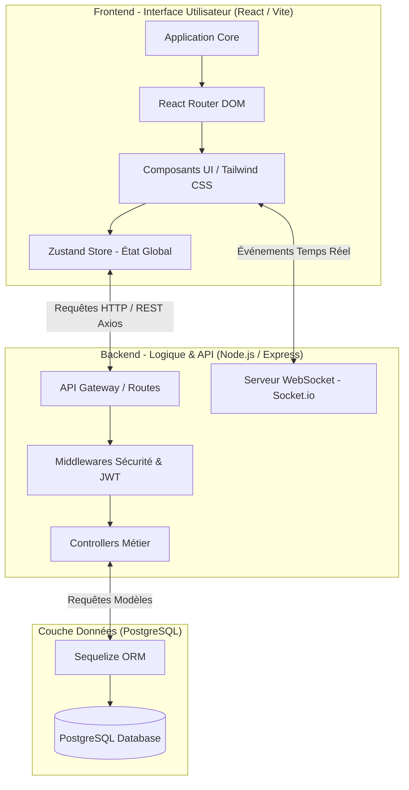
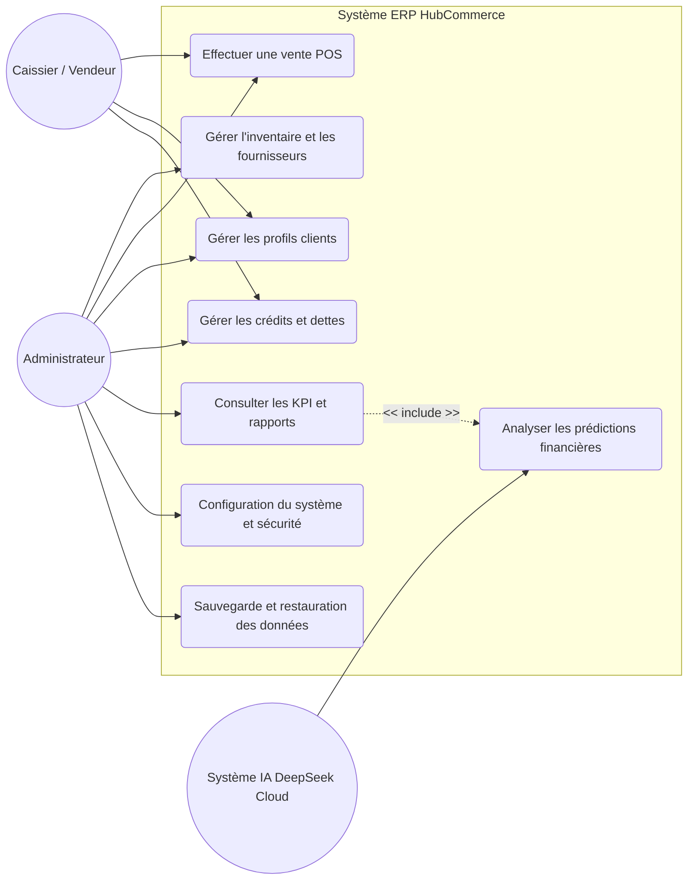
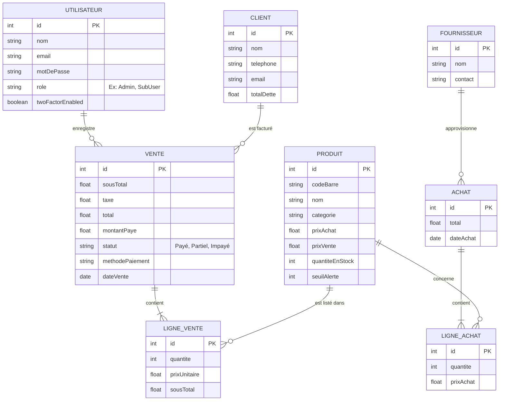
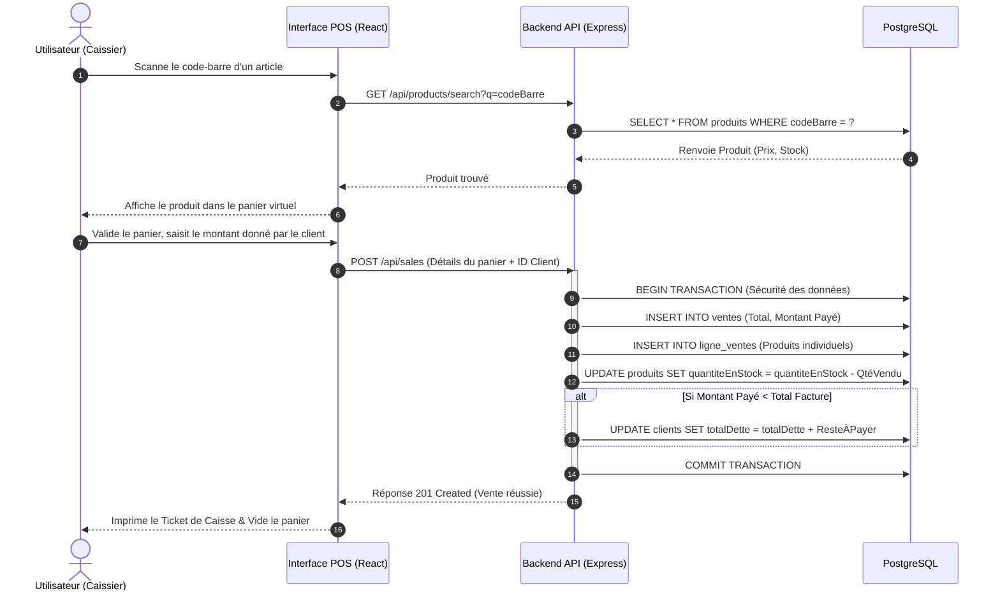
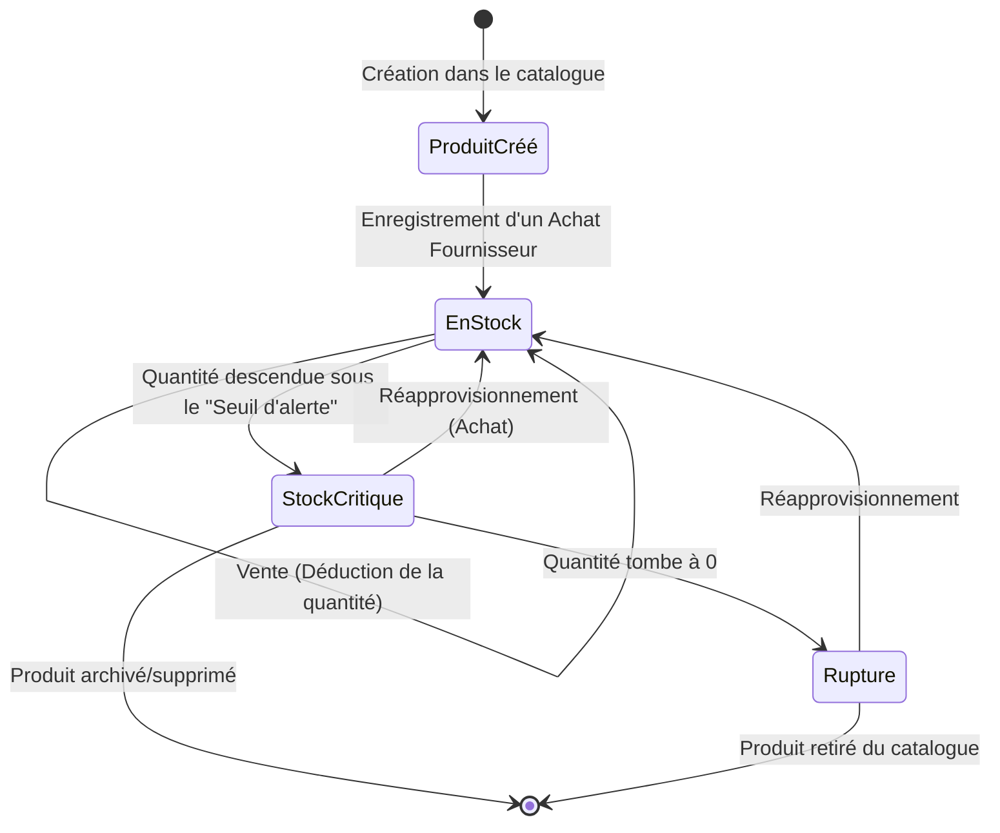

# Rapport Détaillé de Défense - Plateforme HubCommerce (Lumo)

Ce rapport constitue l'annexe technique complète de la plateforme **HubCommerce**. Il détaille exhaustivement l'architecture, le modèle conceptuel, les processus métiers (à travers des diagrammes UML standards), ainsi que les spécifications des modules fonctionnels de l'ERP.

---

## 1. Présentation de l'Architecture Technique

La plateforme repose sur une architecture moderne de type **Single Page Application (SPA)** déconnectée de son API. Cela garantit une séparation des préoccupations (Sécurité, Interface, Données).

### Diagramme de Composants et d'Architecture Globale
Ce diagramme montre comment le frontend interagit avec le backend, la base de données et les services de notification en temps réel.

---

## 2. Diagramme des Cas d'Utilisation (Use Case)

Ce diagramme définit le périmètre du système et les autorisations d'interaction selon le rôle de l'utilisateur (Administrateur global vs Caissier/Vendeur) ainsi que l'intervention de l'Intelligence Artificielle.

---

## 3. Modèle de Données (Diagramme Entité-Association / Classes)

Le modèle conceptuel de données ci-dessous illustre la structure relationnelle de la base de données. Il garantit la traçabilité de chaque produit, de son achat chez un fournisseur jusqu'à sa vente à un client.

---

## 4. Diagramme de Séquence : Le Processus de Vente au POS

Ce diagramme de séquence décrit étape par étape le flux transactionnel critique lors d'une vente en caisse, incluant la vérification du stock, la gestion transactionnelle (ACID) en base de données, et la création de dette en cas de paiement partiel.

---

## 5. Diagramme d'État-Transition : Cycle de vie du Stock

La gestion des stocks est automatisée. Ce diagramme montre les différents états par lesquels un produit peut passer au sein du système.

---

## 6. Détail Exhaustif des Modules et Fonctionnalités

La solution intègre plusieurs modules métiers interagissant en synergie pour fournir un ERP complet.

### 6.1 Module Caisse / Terminal de Vente (POS)
* **Recherche temps réel (Live-Search)** : Les produits s'affichent instantanément à la frappe ou via douchette laser (Code-barres).
* **Multi-devises Natif** : Conversion instantanée des totaux (ex: Achat en USD, paiement client en CDF avec rendu de monnaie en CDF calculé).
* **Validation Transactionnelle** : Bloque la vente si le stock est insuffisant (sauf forçage administrateur).
* **Reçus et Facturation** : Génération de tickets PDF/Thermiques formatés avec le logo et les coordonnées de l'enseigne.

### 6.2 Module CRM et Suivi Financier (Clients & Dettes)
* **Livre des Créances** : Historique granulaire des montants impayés de chaque client.
* **Amortissement des dettes** : Le client peut rembourser sa dette en plusieurs tranches. Chaque tranche génère un reçu de paiement et incrémente la liquidité de la caisse.

### 6.3 Module Inventaire et Fournisseurs (Achats)
* **Approvisionnement traçable** : Lors d'une commande fournisseur, la somme est déduite des caisses (ou génère une dette fournisseur), et les produits sont immédiatement ajoutés au stock physique.
* **Alerte intelligente** : Notification push au sein de l'application lorsqu'un article stratégique s'approche de son seuil critique.

### 6.4 Module Dashboard et Analytics
* **Indicateurs de Performance (KPI)** :
  - *Chiffre d'affaires brut et net.*
  - *Marge bénéficiaire réelle* calculée selon `(Prix Vente - Prix Achat Moyen) * Quantité Vendu`.
  - *Top 5 des produits les plus vendus.*
* **Export de Données** : Fonctionnalité de génération de rapports sous format Microsoft Excel (`.xlsx`) pour traitement comptable externe.

### 6.5 Module LUMO AIO
* **Intégration Modèle LLM** : Connexion à l'API DeepSeek (Modèle `deepseek-chat`).
* **Prédiction algorithmique** : L'IA croise les historiques de ventes pour prédire les pics de demande saisonniers.
* **Analyse de rentabilité textuelle** : Fournit des résumés écrits automatiques au manager ("Attention, la catégorie 'Boissons' génère 40% de revenus en moins ce mois-ci par rapport au mois dernier").

---

## 7. Paramètres Systèmes et Rôles

Le panneau de configuration offre à l'administrateur le contrôle total du comportement de l'ERP.

| Paramètre | Rôle Opérationnel | Impact Système |
| :--- | :--- | :--- |
| **Profil de l'entreprise** | Définit l'identité commerciale (Nom, Logo, Adresse). | Personnalise l'interface et les en-têtes de facturation. |
| **Taux de Change Global** | Valeur de conversion entre la monnaie locale et étrangère. | Met à jour dynamiquement tous les prix au POS. |
| **Bilinguisme (Fr/En)** | Change la langue de l'interface en temps réel. | Traduction instantanée sans rechargement (`useTranslation`). |
| **Sauvegarde JSON** | Permet le téléchargement local d'un snapshot crypté de la base. | Plan de reprise d'activité (Disaster Recovery). |
| **Sécurité 2FA** | Active la double authentification. | Demande un code OTP envoyé par mail avant accès administrateur. |
| **Feature Flags** | Activation/Désactivation des modules (IA, Stocks). | Allège le système pour les structures très basiques. |

---

## 8. Durcissement Production & Stabilisation (Post-Audit)

Suite à un audit technique approfondi, les mesures de stabilisation suivantes ont été implémentées :
*   **Résilience des Mots de Passe** : Protection contre le double-hachage Sequelize via un garde-fou dans les hooks de modèle.
*   **Intégrité des Sessions** : Migration vers un encodage Base64 UTF-8 pour supporter les caractères spéciaux dans les noms d'utilisateurs.
*   **Sécurité SuperAdmin** : Verrouillage matériel des comptes racines pour empêcher toute suppression accidentelle.
*   **Standardisation API** : Unification des formats de réponse pour garantir la fiabilité de l'affichage frontend.
*   **Optimisation de la Latence** : Optimisation des logs d'activité asynchrones pour réduire le temps de réponse du login.

---

**FIN DU RAPPORT**
*Généré pour la défense de fin d'études.*
